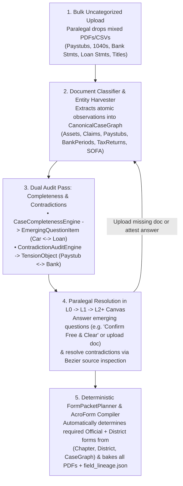

# Bankruptcy v1 Application & Platform Architecture (`BANKRUPTCY_V1_ARCHITECTURE.md`)

- **Repository:** `~/restructure/jd_screen`
- **Status:** Revised Draft for Review (Step 3)
- **Target Scope (v1):** Personal & Small-Business Individual Bankruptcy (Chapter 7 & Chapter 13) across two distinct California federal court filing paths (**`CACB`** NextGen CM/ECF Case Upload and **`CAEB`** Custom e-Filing Portal), built on a generalized entity/ledger graph forward-compatible with **Chapter 11 / Subchapter V**.
- **Deployment Model:** Standalone **Bankruptcy Case Workbench Webapp** (`bankruptcy_main.py`) running completely separately from the **Broadsheet Research Webapp** (`main.py`), while sharing the underlying verification core (`app/core/`) and the `L0 → L1 → L2+` SVG Bezier traceability interaction model.

---

## 1. Shared Verification Spine vs. Application-Specific Deviations

Both the **Broadsheet Research Webapp** and the **Bankruptcy Case Workbench Webapp** solve the same epistemic problem: *every assertion presented to a lawyer must be provably anchored to coordinate-stamped primary evidence `(a)` and controlling legal/regulatory rules `(b)` via an introspectable Toulmin graph (`L0 → L1 → L2+`).*

### 1.1 What Is 100% Shared (`app/core/` & Shared Frontend Traceability Primitives)

| Shared Layer | How Both Applications Use It Identically |
| :--- | :--- |
| **1. Coordinate-Stamped Ingestion (`(a)`)** | `MatterIngestor` indexes raw PDFs and spreadsheets into immutable coordinate-stamped blocks (`SourceLocator`: `file_name`, `page`, `[x1, y1, x2, y2]` bounding box, `sheet!cell_range`, `sha256` digest). |
| **2. Canonical Authorities (`(b)`)** | `CanonicalRouter` serves `[AUTH:...]` statutory rules and effective-dated reference tables (`28 U.S.C. § 1332` in Research; `11 U.S.C. § 109(e)` and `CA CCP § 703.140` in Bankruptcy). |
| **3. Deterministic Citation Verification** | Both verify that every extracted `evidence` quote and numeric primitive literally exists at the cited `SourceLocator` and matches the file’s cryptographic hash. |
| **4. `CompiledBundle` Toulmin Graph (`L0 → L1 → L2+`)** | Both compile into the exact same normalized `CompiledBundle` DAG (`nodes`, `edges`, `tensions`) where `L0` anchors link to `L1` (`evidence`, `calculation`, `reasoning`) and `L2+` (`authority`, statutory tables). |
| **5. SVG Cubic Bezier Traceability UI & `SourceInspectorDrawer`** | Both render `L0` in Column 1, expand `L1` (Column 2) and `L2+` (Column 3) on click with dynamic SVG cubic Bezier curves (`M x1 y1 C ...`), open the slide-over `SourceInspectorDrawer` to highlight the exact PDF `[x1, y1, x2, y2]` bounding box, and use the sticky inline review/override queue. |

### 1.2 What Deviates Between the Two Applications

| Dimension | Broadsheet Research Webapp (`main.py`) | Bankruptcy Case Workbench Webapp (`bankruptcy_main.py`) |
| :--- | :--- | :--- |
| **How `L0` and `L1` Are Constructed** | **LLM-Synthesized Narrative:** Stage 3 LLM drafts `L0` legal prose with `<ref n="X">` clauses; Stage 4 LLM smooths transitions behind `StitchInvariantGate`. | **Deterministic Compiler (Zero LLM Math/Prose):** LLM only extracts atomic `L1` facts (`Stage 2 Harvester`). Pure-Python calculators compute `L1` `calculation` nodes and populate structured `L0` Schedule/Form rows (`Schedule A/B–J`, `Form 122A/C`). |
| **How Ingested Files Connect to Outputs** | **Section-Plan Query Routing:** Stage 1 decomposes question `(c)` into section queries; Stage 2 harvests facts per section. | **Many-to-Many via Canonical Case Graph:** Paralegals drop raw files without picking forms. The harvester extracts domain entities (`AssetItem`, `ClaimItem`, `PaystubRecord`, etc.) into the Case Graph, and a deterministic `FormPacketPlanner` projects the graph into every required form (`B 101`, `B 106A/B–J`, `B 107`, `B 108`, `B 121`, `B 122A/C`, local plans). |
| **Completeness & Emerging Questions** | **Query-Driven Selection:** Harvests only facts relevant to answering user question `(c)`; records passive `UnresolvedGapItem` notes. | **Bidirectional Relational Completeness (`EmergingQuestionItem`):** Actively inspects the Case Graph for implied missing relationships (e.g., *Car on A/B -> "Is there a car loan?"*; *Car loan on D -> "What is the car & its market value?"*; *Missing month in 6-mo CMI lookback*) and blocks filing until answered or attested. |
| **`L0` Column Presentation** | Longform editorial legal brief / memo (`Source Serif 4` narrative paragraphs). | Structured court schedules, Means Test worksheets, and Exemption comparison tables where **every dollar figure, asset, claim, and checkbox is a clickable `<ref>` node** connected via Bezier curves to `L1` and `L2+`. |
| **Downstream Output** | Interactive `CompiledBundle` reading broadsheet. | Official flattened AcroForm PDFs (`PyMuPDF.bake()`), isolated `Form B 121`, `creditor_matrix.txt`, `debtor.txt`, `field_lineage.json`, and `CACB`/`CAEB` court submission. |

---

## 1.3 End-to-End Document-to-Form Workflow (Zero Manual Form Picking)

In bankruptcy, **a single client PDF almost always feeds multiple official forms** (for example, one Auto Loan Statement feeds `Schedule D` secured debt, implies a vehicle asset on `Schedule A/B` + `Schedule C`, feeds monthly payments on `Schedule J` / `Form 122A-2`, and triggers `Form 108` Statement of Intention). Asking a paralegal to manually assign uploaded files to specific forms is error-prone and redundant.

Instead, the application executes a 5-stage **Entity-First Routing & Relational Completeness Workflow**:



1. **Automated Form Selection (`FormPacketPlanner`):**
   - The paralegal never picks individual forms. Given `(chapter, district)` plus the populated `CanonicalCaseGraph`, `FormPacketPlanner` deterministically computes the required form manifest:
     - **Always Required (Ch. 7 & 13 Individual):** `Form B 101` (Voluntary Petition), `Form B 106Sum`, `Schedules A/B, C, D, E/F, G, H, I, J`, `Form B 106Dec`, `Form B 107` (SOFA), `Form B 121` (SSN — isolated PDF), `creditor_matrix.txt`, `debtor.txt`, and District Electronic Filing Declaration (`F 5005-4` for CACB; CAEB e-Filing declaration).
     - **Conditionally Triggered by Case Graph & Chapter:**
       - `Chapter == 7`: `Form B 122A-1` (CMI); if `Above Median`, automatically adds `Form B 122A-2` (Means Test Calculation); if `Schedule D` has secured consumer claims, automatically adds `Form B 108` (Statement of Intention).
       - `Chapter == 13`: `Form B 122C-1` (CMI & Commitment Period); if `Above Median`, automatically adds `Form B 122C-2`; automatically adds mandatory District Chapter 13 Plan (`F 3015-1.01` + `F 3015-1.7.RARA` in CACB; `EDC 3-080` in CAEB).

---

## 2. Standalone Two-Webapp Repository Layout

The two webapps run as **completely separate processes and UIs** with zero cross-app switching in the masthead, while sharing `app/core/` on the backend and a shared ES module (`static/traceability_canvas.js`) for the `L0 → L1 → L2+` Bezier curve canvas and `SourceInspectorDrawer` on the frontend:

```text
~/restructure/jd_screen/
├── main.py                                  # Entrypoint 1: Standalone Broadsheet Research Webapp (port 8000)
├── bankruptcy_main.py                       # Entrypoint 2: Standalone Bankruptcy Case Workbench Webapp (port 8001)
├── app/
│   ├── llm.py                               # Shared LLMProvider gateway
│   ├── ingest.py                            # Shared MatterIngestor & CanonicalRouter (+ OCR & PII hooks)
│   ├── models.py                            # Shared SourceLocator, NodeAudit, TensionObject, CompiledBundle
│   ├── pipeline.py                          # Broadsheet 4-Stage Pipeline
│   ├── routes.py                            # Broadsheet Research FastAPI routes
│   ├── core/
│   │   ├── __init__.py
│   │   ├── ocr.py                           # Pluggable OCRProvider (Modal GPU / Local ONNX-Tesseract / Mock)
│   │   ├── pii.py                           # Deterministic PII tokenizer & local re-hydration vault
│   │   └── tables.py                        # Effective-dated JSON statutory table loader & verifier
│   └── bankruptcy/
│       ├── __init__.py
│       ├── models.py                        # Generalized CanonicalCaseGraph, ProvenanceField, FilingPacket
│       ├── extractor.py                     # Constrained LLM document-to-observation harvester
│       ├── verifier.py                      # Deterministic SourceLocator & numeric/date verifier
│       ├── calculators/
│       │   ├── eligibility.py               # Ch. 7, Ch. 13 (§ 109(e) $2.75M), SubV (§ 1182 $7.5M)
│       │   ├── means_test.py                # 6-mo CMI lookback, Form 122A-1/2 & 122C-1/2 (USTP tables)
│       │   ├── exemptions.py                # Universal multi-regime ExemptionOptimizer (CA § 704 / § 703.140 / Fed § 522(d))
│       │   └── ch13_plan.py                 # Ch. 13 disposable income, liquidation floor, plan math
│       ├── audit.py                         # Declarative Dependency Graph, Forensic Outflow/Plausibility Audit, & Gate
│       ├── bundle_compiler.py               # Compiles CaseGraph + Calculators into L0->L1->L2+ CompiledBundle
│       ├── pdf_engine.py                    # PyMuPDF AcroForm filler, .bake() flattener, overflow sheets
│       ├── districts/
│       │   ├── base.py                      # DistrictAdapter & CourtSubmissionDriver interfaces
│       │   ├── cacb.py                      # Central District (NextGen Case Upload + F 3015-1.01 + F 1007-1)
│       │   └── caeb.py                      # Eastern District (CAEB e-Filing + 8MB splitter + EDC 3-080)
│       ├── vault.py                         # Encrypted Credential + TOTP Vault & Rule 9011 Sign-off Gate
│       └── routes.py                        # Standalone Bankruptcy FastAPI app & routes
├── canonical/
│   ├── legal/                               # [AUTH:...] statutes (11 U.S.C., CA CCP, LBRs)
│   └── tables/
│       └── bankruptcy/                      # Versioned, effective-dated JSON reference tables & PDF templates
├── templates/
│   ├── index.html                           # Broadsheet Research Webapp shell
│   └── bankruptcy.html                      # Standalone Bankruptcy Workbench Webapp shell
└── static/
    ├── styles.css                           # Shared Swiss Quantitative Broadsheet CSS tokens
    ├── app.js                               # Broadsheet Research frontend
    └── bankruptcy.js                        # Standalone Bankruptcy Workbench (uses L0->L1->L2+ Bezier canvas)
```

---

## 3. Five-Layer Anti-Hallucination & Provable Verification Architecture

### Core Invariant: LLMs Never Compute Math, Choose Statutes, or Touch PDFs
1. **What the LLM is allowed to do:** Read coordinate-indexed client documents (`*.indexed.md` / `sheets_index.jsonl`) with text PII masked, and emit candidate `ExtractedFactObservation` records pointing to an existing `SourceLocator` (`file_name`, `page`, `bounding_box`, `locator_key`, `payload_hash`) plus a verbatim quote.
2. **What the LLM is forbidden from doing:** Summing schedules, averaging 6-month paystubs, selecting exemption dollar caps, deciding Chapter 13 debt limits, generating creditor matrix `.txt` files, or writing values directly into PDF forms.

### Layer 1: Coordinate-Stamped Ingestion, Pluggable OCR (`Modal` / Local), & Deterministic PII Masking

#### 1.1 OCR Architecture Tradeoffs & Design (`app/core/ocr.py`)
In bankruptcy, client packets frequently contain scanned PDFs (paystubs, tax returns, bank statements, medical bills). `MatterIngestor` requires **both accurate text/numbers and `[x1, y1, x2, y2]` page bounding boxes** so `SourceInspectorDrawer` can highlight the exact region on a scanned page:

| OCR Approach | Pros | Cons / Risks | Role in Architecture |
| :--- | :--- | :--- | :--- |
| **A. Self-Hosted Layout OCR on Modal GPU (`Surya` / `RapidOCR` / `Docling`)** | Returns exact geometric `[x1, y1, x2, y2]` word/line bounding boxes natively; keeps raw unmasked SSN/bank images inside your own Modal container so `PIITokenizer` masks text *before* any external LLM call; processes 100-page bank packets in seconds on an L4 GPU. | Requires internet + Modal auth token when deployed (`uv run modal deploy`). | **Primary Production OCR (`ModalOCRProvider`)** |
| **B. Local CPU OCR (`RapidOCR` ONNX / `Tesseract`)** | Runs 100% offline inside WSL2 with zero external API calls; returns exact `[x1, y1, x2, y2]` bounding boxes; deterministic for local testing. | Slower than GPU on 100+ page packets (roughly 0.5–1.5s/page on CPU). | **Default Local/Dev Fallback (`LocalOCRProvider`)** |
| **C. External Multimodal LLM as OCR (`Gemini Vision`)** | Strong on cursive handwriting or skewed phone photos. | Cannot mask SSNs/account numbers before sending the raw image to the cloud API; LLM pixel bounding boxes are approximate rather than exact OCR layout boxes; higher latency/cost per page. | **Opt-In Fallback Only (`LLMOCRProvider`)** |

`OCRProvider` implements a clean strategy pattern (`local`, `modal`, `mock`) so `MatterIngestor` seamlessly extracts coordinate-stamped `[x1, y1, x2, y2]` blocks from scanned PDFs and passes the resulting text straight into `PIITokenizer`.

#### 1.2 Deterministic Text PII Masking (`app/core/pii.py`)
- Before any indexed text block is sent to an external `LLMProvider`, `PIITokenizer.mask_text(matter_id, text)` replaces sensitive patterns:
  - Social Security Numbers / ITINs (`\b\d{3}-\d{2}-\d{4}\b`) -> `[PII:SSN_001]`
  - Full Bank / Credit Account Numbers -> `[PII:ACCT_001_LAST4_4829]` (preserving the last 4 digits needed for `Schedule A/B` and `Schedule D/E/F` compliance under **Fed. R. Bankr. P. 9037**, while vaulting the full number).
- Mapping tokens to raw values is stored strictly locally in `matters/<matter_id>/pii_vault.json`.
- Re-hydration (`PIITokenizer.unmask_for_restricted_form`) is callable **only** by the deterministic `Form B 121` (Statement About Your Social Security Numbers) and `debtor.txt` generators.

### Layer 2: Constrained Observation Harvesting & Deterministic Citation Verification

Every value extracted by the LLM from client uploads must pass `ObservationVerifier.verify(observation, matter_ingestor)` before entering the Case Graph:
1. **Locator Existence & Hash Check:** The cited `locator.file_name` and `locator.locator_key` must exist in `matters/<matter_id>/inputs/indexed/*.indexed.md` or `sheets_index.jsonl`, and `locator.payload_hash` must match the file’s SHA-256 digest.
2. **Verbatim Substring & Numeric Anchor Check:**
   - `verbatim_quote` (after whitespace normalization) must be an exact substring of the indexed block at `locator_key`.
   - For numeric fields (`gross_pay`, `ytd_gross`, `ending_balance`, `claim_amount`, `current_value`), the normalized digits of the extracted `Decimal` must appear literally inside `verbatim_quote`.
3. **Failure Handling:** Any mismatch marks the field `verification_status = "unverified"`, which automatically trips the Layer 5 **Strict Zero-Doubt Compiler Gate**.

### Layer 3: Generalized Canonical Case Graph (`ProvenanceField[T]`)

Every field on the Case Graph that feeds a schedule, calculation, or form is wrapped in `ProvenanceField[T]`:

```python
class HumanOverrideRecord(BaseModel):
    """Explicit paralegal/attorney sign-off when overriding or manually supplying a value."""
    actor_name: str
    actor_role: Literal["paralegal", "attorney"]
    rationale: str = Field(min_length=5)
    supporting_locator: Optional[SourceLocator] = None
    overridden_at: str

class ProvenanceField(BaseModel, Generic[T]):
    """Wraps a domain primitive with mandatory cryptographic and coordinate provenance."""
    value: T
    verification_status: Literal["verified", "human_overridden", "unverified", "contradicted"]
    locators: List[SourceLocator] = Field(default_factory=list)
    verbatim_quotes: List[str] = Field(default_factory=list)
    override: Optional[HumanOverrideRecord] = None
```

#### Generalized Entities (Ch. 7 & 13 Now -> Ch. 11 / Subchapter V Ready)
* **`PartyEntity`:** `party_id`, `role` (`"debtor_1"`, `"debtor_2_spouse"`, `"non_filing_spouse"`, `"business_entity"`, `"insider_affiliate"`, `"codebtor"`), `entity_type` (`"individual"`, `"llc"`, `"corporation"`, `"partnership"`), `full_name`, `ssn_token_or_ein`, `county_of_residence`, `ca_domicile_days_continuous: ProvenanceField[int]`, `household_size: ProvenanceField[int]`.
* **`AssetItem` (`Schedule A/B` & `Schedule C`):** `asset_id`, `category`, `description`, `ownership`, `current_value: ProvenanceField[Decimal]`, `acquisition_date: Optional[ProvenanceField[datetime.date]]` (for the **1,215-day `11 U.S.C. § 522(p)`** homestead cap check).
* **`ClaimItem` (`Schedule D` & `Schedule E/F`):** `claim_id`, `creditor_name`, `creditor_address_lines`, `city`, `state`, `zip_code`, `account_token`, `priority_type`, `total_claim_amount: ProvenanceField[Decimal]`, `arrears_amount: Optional[ProvenanceField[Decimal]]`, `collateral_asset_id: Optional[str]`, plus Ch. 13 / Subchapter V eligibility flags (`contingent`, `unliquidated`, `disputed`, `is_insider_or_affiliate`, `commercial_business_pct`).
* **`CashFlowSeries`:** `PaystubRecord`, `BankStatementPeriod`, `TaxReturnSummary`, `MonthlyBudgetScheduleIJ`.
* **`HistoricalTransaction` (`Form 107` SOFA):** Pre-petition payments, lawsuits/garnishments, repossessions, transfers within 2 years.

### Layer 4: Pure-Python Deterministic Statutory Engines & `CompiledBundle` Graph Compiler

All calculations run in pure Python (`Decimal` arithmetic with `ROUND_HALF_UP` to 2 decimal places) against effective-dated JSON reference tables in `canonical/tables/bankruptcy/`:

1. **`EligibilityEngine` (`eligibility.py`):**
   - **Chapter 13 (`11 U.S.C. § 109(e)` per H.R. 7730, effective Nov 10, 2026):** Verifies combined noncontingent, liquidated secured + unsecured debts `< $2,750,000`.
   - **Subchapter V (`11 U.S.C. § 1182` per H.R. 7730):** Verifies non-insider/affiliate noncontingent, liquidated debt `<= $7,500,000` and `>= 50%` commercial/business debt.
2. **`CMIAndMeansTestEngine` (`means_test.py`):**
   - Computes the strict **6 full calendar months lookback window** prior to `expected_filing_date`, averages verified gross income (`CMI`), compares annualized CMI against `ustp_ca_means_test_2026.json` state median for `household_size`, and—if Above Median—applies IRS National & California county Local Standards (`Form 122A-2` / `122C-2`) to test against `11 U.S.C. § 707(b)`.
3. **`ExemptionOptimizer` — Universal Multi-State & Federal Regime Engine (`exemptions.py`):**
   - Rather than hardcoding California logic, the optimizer evaluates a declarative **`ExemptionRegimeSpec` JSON schema** (`canonical/tables/bankruptcy/exemptions_2026.json`) that generalizes across all 50 states and Federal `11 U.S.C. § 522(d)`:
     - **Jurisdiction & Domicile Routing (`11 U.S.C. § 522(b)(3)(A)`):** Checks whether the debtor meets the 730-day continuous domicile requirement; if `< 730 days`, routes to the prior state from the 180-day lookback window or the Federal `§ 522(d)` fallback.
     - **Regime Election (`§ 522(b)(2)`):** Each state defines its selectable regimes (e.g., `CA` is an opt-out state offering `["CA_CCP_704", "CA_CCP_703_140"]`; a dual-election state like `NY` or `TX` offers `["<STATE>_DEFAULT", "FEDERAL_522D"]`; single-regime opt-out states offer `["<STATE>_DEFAULT"]`).
     - **Five Universal Rule Primitives per Exemption Cap:**
       1. `fixed_dollar` (e.g., CA `§ 703.140(b)(2)` vehicle `$8,625`; Federal `§ 522(d)(2)` `$5,025`).
       2. `locality_lookup` (e.g., CA `§ 704.730` 58-county homestead `$371,547`–`$743,681`; NY county tiers).
       3. `unlimited_with_conditions` (e.g., ERISA retirement `§ 522(b)(3)(C)`, or acreage-limited homesteads).
       4. `wildcard_with_spillover` (base wildcard + configurable `%` or cap of unused residence exemption, such as CA `§ 703.140(b)(5)` `$1,950 + 100% unused $36,750 residence` or Federal `§ 522(d)(5)` `$1,675 + up to $15,800 unused homestead`).
       5. `marital_doubling_and_tbe` (`allow_joint_doubling: bool` per `11 U.S.C. § 522(m)`—`False` in CA, `True` under Federal `§ 522(d)`—plus Tenancy by the Entireties flags).
     - **Federal Statutory Clamps:** Automatically enforces the **1,215-day `11 U.S.C. § 522(p)` homestead acquisition cap** across all regimes.
     - **Optimization Output:** Evaluates every eligible regime for the debtor, greedily allocates wildcard spillover to highest non-exempt liquid/personal assets, and returns a side-by-side comparison (`RegimeEvaluationResult`) recommending the regime that minimizes `total_non_exempt_equity`.
4. **`Chapter13PlanCalculator` (`ch13_plan.py`):**
   - Computes 36- vs. 60-month commitment period, priority claims, secured arrears, best-interests-of-creditors liquidation floor (from `ExemptionOptimizer`), and monthly plan payment.
5. **Systematic Dependency Graph, Quantitative Forensics, & Qualitative Plausibility Audit (`audit.py`):**
   - **A. Systematic Cross-Schedule Dependency Graph (`canonical/tables/bankruptcy/dependency_rules.json`):**
     - Rather than relying on an ad-hoc list of 6 checks, completeness dependencies are defined declaratively by mapping every cross-reference across the Official Bankruptcy Forms (`B 101`, `A/B`, `C`, `D`, `E/F`, `G`, `H`, `I`, `J`, `107 SOFA`, `108`, `122A/C`):
       1. *Asset ↔ Secured Claim ↔ Budget ↔ Intention (`A/B` ↔ `D` ↔ `J` ↔ `108`):* Real property (`A/B Part 1`) or Vehicles (`A/B Part 2`) must either link to a secured claim on `D` or carry an explicit `owned_free_and_clear` attestation; every secured claim on `D` must link to a valued collateral asset on `A/B`, a `Form 108` intention (in Ch. 7), and corresponding tax/insurance/operating expenses on `Schedule J`.
       2. *Joint Ownership / Co-Signed Debt ↔ Codebtor (`A/B` or `D/E/F` ↔ `Schedule H`):* Any jointly owned asset (with a non-filing person) or co-signed liability requires a `Schedule H` codebtor entry.
       3. *Housing / Lease Expense ↔ Executory Contracts (`Schedule J` ↔ `Schedule A/B` ↔ `Schedule G`):* If `Schedule A/B` has no real property and `Schedule J Line 4a` has rent `> $0` (or `J Line 17` has a vehicle lease), requires a residential/vehicle lease entry on `Schedule G` (or month-to-month attestation).
       4. *Paystub Line Items ↔ Assets, Priority Claims, & Garnishments (`Paystub` ↔ `A/B`, `E/F`, `I/J`, `SOFA`):*
          - Paystub **401(k)/403(b)/Pension/HSA deduction** `> $0` -> requires matching retirement/HSA account on `Schedule A/B (Line 21 / 17)`.
          - Paystub **Wage Garnishment / Support deduction** `> $0` -> requires creditor on `Schedule E/F` + lawsuit/garnishment disclosure on `SOFA Line 9` (or DSO on `Schedule E/F` + `Schedule J Line 18`).
       5. *Tax Return (`1040`) Schedules ↔ Assets, Claims, & Business Disclosures:*
          - `1040 Schedule B` (interest/dividends) -> requires matching bank/brokerage accounts on `Schedule A/B`.
          - `1040 Schedule C / E / K-1` (business/rental/entity income) -> requires business interest on `Schedule A/B Part 4`, `SOFA Line 27`, and 6-month P&L attachment on `Schedule I Line 8a`.
          - `1040` refund owed -> `Schedule A/B Line 28` asset; `1040` tax balance due -> `Schedule E/F` priority tax claim.
       6. *Temporal Lookback Coverage:* Mandatory 6-calendar-month CMI income coverage (`Form 122A-1/C-1`) and 2-calendar-year `SOFA Part 2` income history.
   - **B. Quantitative Ledger Forensics (Detecting Unlisted Accounts & Missing Debt From Cash Flows):**
     - **Bank Statement Debt-Service Outflow Matcher:** Scans 6 months of bank statement debits/ACH outflows for recurring payments to lenders, credit cards, auto finance, BNPL, or collection agencies. Any payee receiving debt-like outflows in bank statements that has no matching creditor on `Schedule D` or `E/F` triggers a critical `UNLISTED_CREDITOR_FROM_BANK_OUTFLOW` prompt (*"Bank statement shows $340/mo ACH to 'SYNCHRONY BANK', which is missing from Schedules D/E/F"*).
     - **Inter-Account Transfer Tracer:** Flags bank transfers (`Zelle`, `Venmo`, `ACH Transfer to Acct ...XXXX`) where the destination account is not listed on `Schedule A/B` or `SOFA` (`UNDISCLOSED_ACCOUNT_TRANSFER`).
     - **Cash-Flow Conservation Identity:** Flags cases where `6-Month Verified Net Income - 6-Month Bank Ending Balance Change` diverges significantly from reported `Schedule J` expenses + debt service.
   - **C. Qualitative & Statistical Plausibility Auditor (`PlausibilityAuditEngine` + Calibrated `evaluate_decisions`):**
     - **Statistical & Baseline Budget Sanity Checks:** Flags implausible omissions (e.g., `$0` food, `$0` utilities, `$0` clothing/medical on `Schedule J`; owning a vehicle on `A/B` with `$0` insurance/fuel on `J`; filing Chapter 7 with anomalously low total unsecured debt relative to income—*"Client may have omitted credit report / medical / personal debts"*).
     - **Calibrated LLM Forensic Review (`LLMProvider.evaluate_decisions`):** Runs calibrated probability/rubric checks over the assembled `CanonicalCaseGraph` to surface high-probability missing-document hypotheses as non-blocking warnings (`severity="warning"`) for paralegal review.
6. **`BankruptcyBundleCompiler` (`bundle_compiler.py`):**
   - Deterministically compiles the Case Graph, calculator outputs, `EmergingQuestionItem`s, and `TensionObject`s into a **`CompiledBundle` (`L0 → L1 → L2+` DAG)** where:
     - **`L0` Sections** represent the structured schedules and worksheets (`Petition & Eligibility`, `Schedule A/B & C (Property & Exemptions)`, `Schedule D & E/F (Creditors)`, `Schedule I & J (Budget)`, `Form 122A/C (CMI & Means Test)`, `Form 107 (SOFA)`). Every line item, total, and statutory conclusion in `L0` is an interactive `<ref id="claim_...">` node.
     - **`L1` Nodes** are the deterministic `calculation` plates (showing the exact formula and inputs, e.g., `=SUM(Paystubs_May_Oct)/6`) and `evidence` plates (with verbatim quotes and `SourceLocator` PDF bounding boxes).
     - **`L2+` Nodes** are the controlling `authority` plates (`11 U.S.C. § 109(e)`, `CA CCP § 704.730`, `USTP Table 2026-11`, `EJ-156`).

### Layer 5: Strict Zero-Doubt Compiler Gate & Provable `FieldLineageManifest`

`FilingReadinessGate.evaluate(case)` returns `status: "BLOCKED" | "READY"` and hard-blocks Filing Packet compilation or submission if:
1. Any populated `ProvenanceField` has `verification_status in ("unverified", "contradicted")` without a valid `HumanOverrideRecord`.
2. Any `EmergingQuestionItem` (missing relational/completeness check) or `TensionObject` (cross-document contradiction) with `severity == "critical"` is unresolved.
3. Any required document (determined by `FormPacketPlanner`) is missing, unbaked, oversized (`> 50 MB` in CACB or `> 8 MB` in CAEB), fails to isolate `Form B 121`, or violates creditor matrix `.txt` line/character/exclusion rules.

Every compiled packet includes `field_lineage.json`, mapping every filled PDF widget (`form_id`, `pdf_field_name`, `rendered_value`) back to its `L0/L1` node ID, formula, and `SourceLocator` bounding box.

---

## 4. Multi-District Filing Architecture (`CACB` & `CAEB`) & Credential Vault

### 4.1 Two District Filing Paths (`app/bankruptcy/districts/`)

| Capability | Path 1: `CACBDistrictAdapter` (Central District) | Path 2: `CAEBDistrictAdapter` (Eastern District) |
| :--- | :--- | :--- |
| **Target Portal** | NextGen CM/ECF (`ecf.cacb.uscourts.gov` / `ecf-train.cacb.uscourts.gov`) | Custom `CAEB e-Filing` (`efiling3.caeb.uscourts.gov`) + PACER |
| **Case Upload File** | `debtor.txt` (CM/ECF Case Upload format for Ch. 7 & Ch. 13; blocked for Ch. 11) | `debtor.txt` uploaded via CAEB e-Filing *Upload New Case Data File* |
| **Creditor Matrix `.txt`** | Max 5 lines, 50-char name / 40-char address, **auto-strips Debtor, UST, IRS, FTB**; generates `F 1007-1` verification PDF | Max 5 lines × 40 chars, zero leading spaces, ASCII `.txt` |
| **Local Ch. 13 Plan** | `F 3015-1.01.CHAPTER13.PLAN` + `F 3015-1.7.RARA` | `EDC 3-080` Chapter 13 Plan |
| **E-Filing Declaration** | `F 5005-4` Electronic Filing Declaration | CAEB Electronic Signature Verification Form |
| **PDF Packet Splitting & Size Cap** | Separates `Form B 121` (SSN) + `Chapter 13 Plan`; max **50 MB** per PDF; baked via `PyMuPDF.bake()` | Separates `Form B 121` (SSN) + `EDC 3-080`; auto-chunks attachments to strictly **`<= 8 MB`** per PDF |

### 4.2 Internal Credential + TOTP Vault & Rule 9011 Gate (`app/bankruptcy/vault.py`)
- Supports three credential modes: `ecf_train` (default dev/test), `filing_agent` (design partner sub-account), and `firm_attorney` (internal AI-native firm credentials + `pyotp` TOTP generator).
- Requires a cryptographic `Rule9011SignOffToken` (minted only when `FilingReadinessGate == "READY"`, the signed declaration is hashed on file, and an attorney submits the Rule 9011 attestation).

---

## 5. Standalone Bankruptcy Webapp API & Bezier Traceability UI

### 5.1 REST API (`bankruptcy_main.py`)
* `GET /` — Serves the standalone Bankruptcy Case Workbench (`templates/bankruptcy.html` + `static/bankruptcy.js`).
* `GET /api/v1/bankruptcy/tables` — Lists loaded effective-dated statutory reference tables and SHA-256 checksums.
* `POST /api/v1/bankruptcy/matters` & `GET /api/v1/bankruptcy/matters` — Creates and lists bankruptcy case matters.
* `POST /api/v1/bankruptcy/matters/{matter_id}/upload` — Uploads client PDFs/spreadsheets, runs `MatterIngestor` (with `OCRProvider` + `PIITokenizer`), and indexes coordinates.
* `POST /api/v1/bankruptcy/matters/{matter_id}/extract` — Harvests verified observations into `CanonicalCaseGraph`, runs all deterministic calculators (`Eligibility`, `MeansTest`, `ExemptionOptimizer`, `Ch13Plan`), `CaseCompletenessEngine`, and `ContradictionAuditEngine`, and compiles the `L0 → L1 → L2+` `CompiledBundle`.
* `GET /api/v1/bankruptcy/matters/{matter_id}/case` — Returns `BankruptcyCaseState` + `CompiledBundle` (for Bezier canvas rendering) + `EmergingQuestions` + `FilingReadinessReport`.
* `PATCH /api/v1/bankruptcy/matters/{matter_id}/fields` — Applies an audited `HumanOverrideRecord` to a field and deterministically recompiles all calculators and the `CompiledBundle` in `< 100ms`.
* `POST /api/v1/bankruptcy/matters/{matter_id}/questions/{question_id}/answer` — Answers an `EmergingQuestionItem` (e.g., confirming a car is owned free-and-clear, supplying a missing vehicle value, or attesting `$0` income for a lookback month) with an audited `HumanOverrideRecord` or linked `SourceLocator`, updating the Case Graph and re-evaluating `FilingReadinessGate`.
* `POST /api/v1/bankruptcy/matters/{matter_id}/tensions/{tension_id}/resolve` — Resolves a critical contradiction with rationale + `SourceLocator` and re-evaluates `FilingReadinessGate`.
* `POST /api/v1/bankruptcy/matters/{matter_id}/compile-packet` — Enforces `FilingReadinessGate`, runs `FormPacketPlanner` to determine all required forms, and bakes AcroForm PDFs (`B 101`, `B 106*`, `B 107`, `B 108`, isolated `B 121`, `B 122A/C`, district Ch. 13 plan), continuation sheets, `creditor_matrix.txt`, `debtor.txt`, and `field_lineage.json`.
* `GET /api/v1/bankruptcy/matters/{matter_id}/packet/files/{filename}` — Serves generated PDFs, `.txt` files, and `field_lineage.json`.
* `POST /api/v1/bankruptcy/matters/{matter_id}/submit` — Validates `Rule9011SignOffPayload` and executes `CACB` or `CAEB` submission driver, returning `CourtFilingReceipt`.

### 5.2 Bankruptcy UI: `L0 → L1 → L2+` Bezier Traceability Canvas + Filing Drawer (`static/bankruptcy.js`)
Instead of inventing a disconnected provenance table, the Bankruptcy Workbench directly uses the **3-Column Progressive Bounded Broadsheet + SVG Cubic Bezier Traceability Canvas**:
1. **Column 1 (`L0 · Case Schedules, Calculators, & Contradictions`):**
   - Renders the case’s active **Contradiction Callouts** (at top in Editorial Crimson `#991B1B`), followed by structured **Swiss Quantitative Broadsheet Tables** for `Voluntary Petition & Eligibility`, `Schedule A/B (Assets)`, `Schedule C (Dual-System Exemption Optimizer: § 704 vs § 703.140)`, `Schedules D & E/F (Secured & Unsecured Claims)`, `Schedules I & J (Monthly Budget)`, and `Form 122A/C (6-Month CMI & Means Test)`.
   - Every dollar value, asset row, claim row, and statutory verdict in `L0` is a clickable `<ref>` clause badge (`#EDF2F8` Oxford Navy tint, or `#FFFBEB` Warm Ochre dashed underline if overridden/unverified).
2. **Column 2 (`L1 · Primary Support: Math & Client Evidence`):**
   - Clicking any number or row in `L0` draws **1.5px Oxford Navy SVG cubic Bezier curves** to Column 2 (`L1`), displaying:
     - `FIG. 1.1 · CALCULATION`: The exact deterministic formula and line-item inputs (e.g., `6-Month CMI = ($5,200 + $5,200 + ...) / 6 = $5,420.00` or `§ 703.140(b)(5) Wildcard Allocation`).
     - `FIG. 1.2+ · EVIDENCE · PDF`: The exact client paystubs, bank statements, tax returns, or bills with verbatim quotes and `Inspect Source` buttons, plus an inline **`Override / Edit Value`** control.
3. **Column 3 (`L2+ · Backing Statutory Authorities & Reference Tables`):**
   - Clicking a statutory rule or table reference inside `L1` draws secondary Bezier curves to Column 3 (`L2+`), displaying the controlling statute (`[AUTH:11_USC_109_E]`, `[AUTH:CA_CCP_704_730]`) or exact row from the effective-dated JSON reference table (`ustp_ca_means_test_2026.json`, `ca_exemptions_ej156_2026.json`).
4. **Slide-Over `SourceInspectorDrawer` & `FilingPacketDrawer`:**
   - Clicking **`Inspect Source`** on any `L1`/`L2+` plate opens `SourceInspectorDrawer` to the client PDF page with `[x1, y1, x2, y2]` bounding-box highlighting.
   - Clicking **`Filing Gate & Packet (`CACB` / `CAEB`)`** in the top bar opens the **Strict Zero-Doubt Filing Readiness Checklist**, PDF/Matrix previewer, and **Rule 9011 Attorney Sign-Off & Submit** modal.
