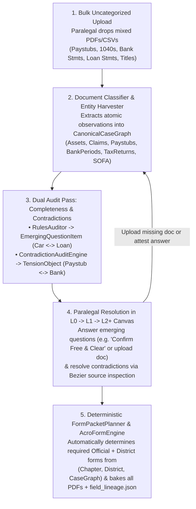

# Bankruptcy v1 Application & Platform Architecture (`BANKRUPTCY_V1_ARCHITECTURE.md`)

- **Repository:** `~/restructure/jd_screen`
- **Status:** Implemented & Verified (Unified Platform & Pluggable Compilers — `81 passed` offline)
- **Target Scope:** Personal & Small-Business Individual Bankruptcy (Chapter 7 & Chapter 13) across two distinct California federal court filing paths (**`CACB`** NextGen CM/ECF Case Upload and **`CAEB`** Custom e-Filing Portal), built on a generalized entity/ledger graph forward-compatible with **Chapter 11 / Subchapter V**.
- **Deployment Model:** Unified single-server platform ([main.py](file:///home/ben/restructure/jd_screen/main.py), port `8000`) co-mounting the **Bankruptcy Case Workbench** at `/bankruptcy` (`GET / → 307 /bankruptcy`) alongside the **Research Broadsheet** at `/research`, with an auto-hiding top-bar App Switcher (`GET /api/v1/apps`). Single-app deployments (`--apps bankruptcy` or `bankruptcy_main.py` on port `8001`) delegate to the exact same `create_platform_app` factory.

---

## 1. Shared Verification Spine vs. Application-Specific Compilers

Both the **Research Broadsheet Compiler** and the **Bankruptcy Compiler** solve the same epistemic problem: *every assertion presented to a lawyer must be provably anchored to coordinate-stamped primary evidence `(a)` and controlling legal/regulatory rules `(b)` via an introspectable Toulmin graph (`L0 → L1 → L2+`).*

### 1.1 What Is 100% Shared (`app/core/` & `static/core/`)

| Shared Layer | How Both Applications Use It Identically |
| :--- | :--- |
| **1. Coordinate-Stamped Ingestion (`(a)`)** | `MatterIngestor` indexes raw PDFs, spreadsheets, `event_log` JSON events, and sibling compiler `calculation_ledger` snapshots (`ledgers/<app>.json`) into immutable coordinate-stamped blocks (`SourceLocator`: `file_name`, `page`, `[x1, y1, x2, y2]`, `sheet!cell_range`, `json_path`, `sha256` digest). |
| **2. Canonical Authorities & Reference Tables (`(b)`)** | `CanonicalRouter` serves `[AUTH:...]` statutory rules, while `ReferenceTableRegistry` / `StatutoryTableRegistry` manages effective-dated JSON tables (`28 U.S.C. § 1332` in Research; `11 U.S.C. § 109(e)` and `CA CCP § 703.140` in Bankruptcy). |
| **3. Deterministic Citation Verification** | `ObservationVerifier` checks that every extracted `evidence` quote and numeric primitive literally exists at the cited `SourceLocator` and matches the file’s cryptographic hash. |
| **4. `CompiledBundle` Toulmin Graph (`L0 → L1 → L2+`)** | Both compile into the normalized `CompiledBundle` DAG (`nodes`, `edges`, `tensions`) behind `BaseCompiler`, where `L0` anchors link to `L1` (`evidence`, `calculation`, `reasoning`) and `L2+` (`authority`, statutory tables). |
| **5. Three-Tier Slot UI (`static/core/`)** | Both compose `PlatformShell` (top bar + auto-hiding App Switcher), `TraceabilityCanvas` (`L0 → L1 → L2+` Bezier curves), polymorphic `SourceInspectorDrawer`, and `TriageStepperFrame`. |

### 1.2 What Deviates Between the Two Compilers

| Dimension | Research Broadsheet Compiler (`/research`) | Bankruptcy Workbench Compiler (`/bankruptcy`) |
| :--- | :--- | :--- |
| **How `L0` and `L1` Are Constructed** | **LLM-Synthesized Narrative:** Stage 3 LLM drafts `L0` legal prose with `<ref n="X">` clauses; Stage 4 LLM smooths transitions behind `StitchInvariantGate`. | **Deterministic Compiler (Zero LLM Math/Prose):** LLM only extracts atomic `L1` observations (`extractor.py`). Pure-Python `ChapterCalculatorDispatch` engines compute `L1` `calculation` nodes and populate structured `L0` Schedule/Form rows (`Schedule A/B–J`, `Form 122A/C`). |
| **How Ingested Files Connect to Outputs** | **Section-Plan Query Routing:** Stage 1 decomposes question `(c)` into section queries; Stage 2 harvests facts per section (including sibling `ledgers/*.json`). | **Many-to-Many via Canonical Case Graph:** Paralegals drop raw files without picking forms. The harvester extracts domain entities (`AssetItem`, `ClaimItem`, `PaystubRecord`, etc.) into the Case Graph, and `FormPacketPlanner` projects the graph into every required form (`B 101`, `B 106A/B–J`, `B 107`, `B 108`, `B 121`, `B 122A/C`, local plans). |
| **Completeness & Emerging Questions** | **Query-Driven Selection:** Harvests facts relevant to answering user question `(c)`; records passive `UnresolvedGapItem` notes. | **Bidirectional Relational Completeness (`EmergingQuestionItem`):** Inspects the Case Graph for implied missing relationships (e.g., *Car on A/B -> "Is there a car loan?"*; *Car loan on D -> "What is the car & its market value?"*; *Missing month in 6-mo CMI lookback*) and blocks filing until answered or attested. |
| **`L0` Column Presentation** | Longform editorial legal brief / memo (`Source Serif 4` narrative paragraphs). | Structured court schedules, Means Test worksheets, and Exemption comparison tables where **every dollar figure, asset, claim, and checkbox is a clickable `<ref>` node** connected via Bezier curves to `L1` and `L2+`. |
| **Downstream Output** | Interactive `CompiledBundle` reading broadsheet. | Official flattened AcroForm PDFs (`AcroFormEngine` + `PyMuPDF.bake()`), isolated `Form B 121`, `creditor_matrix.txt`, `debtor.txt`, `field_lineage.json`, published `ledgers/bankruptcy.json`, and `CACB`/`CAEB` court submission. |

---

## 1.3 End-to-End Document-to-Form Workflow (Zero Manual Form Picking)

In bankruptcy, **a single client PDF almost always feeds multiple official forms** (for example, one Auto Loan Statement feeds `Schedule D` secured debt, implies a vehicle asset on `Schedule A/B` + `Schedule C`, feeds monthly payments on `Schedule J` / `Form 122A-2`, and triggers `Form 108` Statement of Intention). Asking a paralegal to manually assign uploaded files to specific forms is error-prone and redundant.

Instead, the application executes a 5-stage **Entity-First Routing & Relational Completeness Workflow**:



1. **Automated Form Selection (`FormPacketPlanner`):**
   - The paralegal never picks individual forms. Given `(chapter, district)` plus the populated `CanonicalCaseGraph`, `FormPacketPlanner` deterministically computes the required form manifest:
     - **Always Required (Ch. 7 & 13 Individual):** `Form B 101` (Voluntary Petition), `Form B 106Sum`, `Schedules A/B, C, D, E/F, G, H, I, J`, `Form B 106Dec`, `Form B 107` (SOFA), `Form B 121` (SSN — isolated PDF), `creditor_matrix.txt`, `debtor.txt`, and District Electronic Filing Declaration (`F 5005-4` for CACB; CAEB e-Filing declaration).
     - **Conditionally Triggered by Case Graph & Chapter:**
       - `Chapter == 7`: `Form B 122A-1` (CMI); if `Above Median`, automatically adds `Form B 122A-2` (Means Test Calculation); if `Schedule D` has secured consumer claims, automatically adds `Form B 108` (Statement of Intention).
       - `Chapter == 13`: `Form B 122C-1` (CMI & Commitment Period); if `Above Median`, automatically adds `Form B 122C-2`; automatically adds mandatory District Chapter 13 Plan (`F 3015-1.01` + `F 3015-1.7.RARA` in CACB; `EDC 3-080` in CAEB).

---

## 2. Unified Platform & Pluggable Compilers Repository Layout

The platform co-hosts both `/bankruptcy` and `/research` in one FastAPI server ([app/server.py](file:///home/ben/restructure/jd_screen/app/server.py)) behind clean `/api/v1/` routes while keeping all domain logic cleanly isolated under `app/compilers/`:

```text
~/restructure/jd_screen/
├── main.py                                  # Unified platform CLI & server (`--apps`, `--default-app`, `--sync-tables`, port 8000)
├── bankruptcy_main.py                       # Single-app Bankruptcy server preset (`--apps bankruptcy`, port 8001)
├── app/
│   ├── server.py                            # Unified FastAPI app factory, COMPILER_REGISTRY, /api/v1/{apps,tables,canonical,matters}/*
│   ├── core/
│   │   ├── bundle.py                        # Normalized CompiledBundle DAG, SectionValidator, StitchInvariantGate
│   │   ├── provenance.py                    # Generic ProvenanceField[T], HumanOverrideRecord, EmergingQuestionItem, FieldLineageEntry
│   │   ├── workspace.py                     # MatterWorkspace, VerifiedLedgerSnapshot (ledgers/<app>.json + SHA-256)
│   │   ├── gate.py                          # ReadinessGate & SignOffGate protocols
│   │   ├── compiler.py                      # BaseCompiler protocol
│   │   ├── verifier.py                      # Deterministic ObservationVerifier (PDF/XLSX/JSONPath/hash checks)
│   │   ├── ingest.py                        # CanonicalIngestor, CanonicalRouter, MatterIngestor (incl. event_log & ledger indexing)
│   │   ├── llm.py                           # Provider-agnostic LLMProvider gateway (Gemini Interactions + Decisions API)
│   │   ├── ocr.py                           # Pluggable OCRProvider (Modal GPU / Local ONNX-Tesseract / Mock)
│   │   ├── pii.py                           # Deterministic PII tokenizer & local re-hydration vault
│   │   ├── tables.py                        # ReferenceTableRegistry & StatutoryTableRegistry (staleness + SHA-256 sync)
│   │   └── pdf_forms.py                     # Generic AcroFormEngine (widget binding, overflow sheets, .bake(), field_lineage.json)
│   └── compilers/
│       ├── research/
│       │   ├── pipeline.py                  # Broadsheet 4-stage pipeline + batch comment regenerator
│       │   ├── sample_data.py               # Pre-loaded legal motion (28 U.S.C. § 1332) & candidate screen bundles
│       │   ├── service.py                   # Research workspace & bundle store services
│       │   └── routes.py                    # /api/v1/research/* endpoints
│       └── bankruptcy/
│           ├── schema.py                    # CanonicalCaseGraph, 53-line AssetItem, ClaimItem, PaystubRecord
│           ├── extractor.py                 # Constrained LLM + deterministic harvester
│           ├── calculators/
│           │   ├── registry.py              # ChapterCalculatorDispatch ("7", "13", "11_subv")
│           │   ├── eligibility.py           # Ch. 7, Ch. 13 (§ 109(e) $2.75M), SubV (§ 1182 $7.5M)
│           │   ├── means_test.py            # 6-mo CMI, MFS Column B Spouse CMI & Marital Adjustment
│           │   ├── exemptions.py            # Universal ExemptionOptimizer (CA § 704 / § 703.140 / Fed § 522(d), Schwab 100% FMV, §§ 522(p)/(n)/(o), § 541(b))
│           │   └── ch13_plan.py             # Ch. 13 910-day cramdown, Zimmer/Lam lien strip, trustee/RARA fees, § 1325(a)(6) feasibility
│           ├── rules_auditor.py             # 22 Declarative Rules, Trauma/SOFA/60d-Paystub Forensics, Plausibility, & FilingReadinessGate
│           ├── bundle_adapter.py            # Compiles CaseGraph + Calculators into official-form-aligned L0->L1->L2+ CompiledBundle
│           ├── form_binder.py               # FormPacketPlanner & Official AcroForm mapping (delegating PDF mechanics to AcroFormEngine)
│           ├── districts/
│           │   ├── base.py                  # DistrictAdapter & CourtSubmissionDriver interfaces
│           │   ├── cacb.py                  # Central District (NextGen Case Upload + F 3015-1.01 + F 1007-1)
│           │   └── caeb.py                  # Eastern District (CAEB e-Filing + 8MB splitter + EDC 3-080)
│           ├── vault.py                     # Encrypted Credential + TOTP Vault & Rule 9011 Sign-off Gate
│           ├── sample_cases.py              # Pre-seeded Martinez (Ch. 7 CACB) & Chen (Ch. 13 CAEB) cases
│           ├── service.py                   # BankruptcyCaseService orchestrator (+ VerifiedLedgerSnapshot publishing)
│           └── routes.py                    # /api/v1/bankruptcy/* FastAPI routes & create_bankruptcy_app wrapper
├── canonical/
│   ├── bankruptcy/                          # 14 official [AUTH:...] CACB LBR, CAEB LBR, U.S. Courts & CA CCP statutes
│   ├── legal/                               # [AUTH:...] federal statutes
│   └── tables/
│       └── bankruptcy/                      # Versioned JSON tables (exemptions, USTP, federal thresholds, taxonomy, form_field_maps) & 25 fillable PDF templates (gitignored)
├── templates/
│   ├── bankruptcy.html                      # Bankruptcy Workbench shell (default `/`)
│   └── research.html                        # Research Broadsheet shell (`/research`)
└── static/
    ├── styles.css                           # Shared Swiss Quantitative Broadsheet CSS tokens
    ├── core/
    │   ├── shell.js                         # PlatformShell (auto-hiding App Switcher), SVG icons & formatters
    │   ├── canvas.js                        # TraceabilityCanvas, BezierConnectorLayer, RichRefBlock, renderAnnotatedText
    │   ├── inspector.js                     # Polymorphic SourceInspectorDrawer (PDF, XLSX, ledger, event_log, API, DB, web)
    │   └── stepper.js                       # TriageStepperFrame (blocker/advisory navigation frame)
    └── apps/
        ├── bankruptcy/app.js                # Bankruptcy Workbench slots (Official Form L0, 12-rule stepper, FilingPacketDrawer)
        └── research/app.js                  # Research Broadsheet slots (AskPipelineDialog, CorpusManagerModal, CheckpointReviewModal)
```

---

## 3. Five-Layer Anti-Hallucination & Provable Verification Architecture

### Core Invariant: LLMs Never Compute Math, Choose Statutes, or Touch PDFs
1. **What the LLM is allowed to do:** Read coordinate-indexed client documents (`*.indexed.md` / `sheets_index.jsonl`) with text PII masked, and emit candidate `ExtractedFactObservation` records pointing to an existing `SourceLocator` (`file_name`, `page`, `bounding_box`, `locator_key`, `payload_hash`) plus a verbatim quote.
2. **What the LLM is forbidden from doing:** Summing schedules, averaging 6-month paystubs, selecting exemption dollar caps, deciding Chapter 13 debt limits, generating creditor matrix `.txt` files, or writing values directly into PDF forms.

### Layer 1: Coordinate-Stamped Ingestion, Pluggable OCR (`Modal` / Local), & Deterministic PII Masking

#### 1.1 OCR Architecture Tradeoffs & Design (`app/core/ocr.py`)
In bankruptcy, client packets frequently contain scanned PDFs (paystubs, tax returns, bank statements, medical bills). `MatterIngestor` requires **both accurate text/numbers and `[x1, y1, x2, y2]` page bounding boxes** so `SourceInspectorDrawer` can highlight the exact region on a scanned page:

| OCR Approach | Pros | Cons / Risks | Role in Architecture |
| :--- | :--- | :--- | :--- |
| **A. Self-Hosted Layout OCR on Modal GPU (`Surya` / `RapidOCR` / `Docling`)** | Returns exact geometric `[x1, y1, x2, y2]` word/line bounding boxes natively; keeps raw unmasked SSN/bank images inside your own Modal container so `PIITokenizer` masks text *before* any external LLM call; processes 100-page bank packets in seconds on an L4 GPU. | Requires internet + Modal auth token when deployed (`uv run modal deploy`). | **Primary Production OCR (`ModalOCRProvider`)** |
| **B. Local CPU OCR (`RapidOCR` ONNX / `Tesseract`)** | Runs 100% offline inside WSL2 with zero external API calls; returns exact `[x1, y1, x2, y2]` bounding boxes; deterministic for local testing. | Slower than GPU on 100+ page packets (roughly 0.5–1.5s/page on CPU). | **Default Local/Dev Fallback (`LocalOCRProvider`)** |
| **C. External Multimodal LLM as OCR (`Gemini Vision`)** | Strong on cursive handwriting or skewed phone photos. | Cannot mask SSNs/account numbers before sending the raw image to the cloud API; LLM pixel bounding boxes are approximate rather than exact OCR layout boxes; higher latency/cost per page. | **Opt-In Fallback Only (`LLMOCRProvider`)** |

`OCRProvider` implements a clean strategy pattern (`local`, `modal`, `mock`) so `MatterIngestor` seamlessly extracts coordinate-stamped `[x1, y1, x2, y2]` blocks from scanned PDFs and passes the resulting text straight into `PIITokenizer`.

#### 1.2 Deterministic Text PII Masking (`app/core/pii.py`)
- Before any indexed text block is sent to an external `LLMProvider`, `PIITokenizer.mask_text(matter_id, text)` replaces sensitive patterns:
  - Social Security Numbers / ITINs (`\b\d{3}-\d{2}-\d{4}\b`) -> `[PII:SSN_001]`
  - Full Bank / Credit Account Numbers -> `[PII:ACCT_001_LAST4_4829]` (preserving the last 4 digits needed for `Schedule A/B` and `Schedule D/E/F` compliance under **Fed. R. Bankr. P. 9037**, while vaulting the full number).
- Mapping tokens to raw values is stored strictly locally in `matters/<matter_id>/pii_vault.json`.
- Re-hydration (`PIITokenizer.unmask_for_restricted_form`) is callable **only** by the deterministic `Form B 121` (Statement About Your Social Security Numbers) and `debtor.txt` generators.

### Layer 2: Constrained Observation Harvesting & Deterministic Citation Verification

Every value extracted by the LLM from client uploads must pass `ObservationVerifier.verify(observation, matter_ingestor)` before entering the Case Graph:
1. **Locator Existence & Hash Check:** The cited `locator.file_name` and `locator.locator_key` must exist in `matters/<matter_id>/inputs/indexed/*.indexed.md` or `sheets_index.jsonl`, and `locator.payload_hash` must match the file’s SHA-256 digest.
2. **Verbatim Substring & Numeric Anchor Check:**
   - `verbatim_quote` (after whitespace normalization) must be an exact substring of the indexed block at `locator_key`.
   - For numeric fields (`gross_pay`, `ytd_gross`, `ending_balance`, `claim_amount`, `current_value`), the normalized digits of the extracted `Decimal` must appear literally inside `verbatim_quote`.
3. **Failure Handling:** Any mismatch marks the field `verification_status = "unverified"`, which automatically trips the Layer 5 **Strict Zero-Doubt Compiler Gate**.

### Layer 3: Generalized Canonical Case Graph (`ProvenanceField[T]`)

Every field on the Case Graph that feeds a schedule, calculation, or form is wrapped in `ProvenanceField[T]`:

```python
class HumanOverrideRecord(BaseModel):
    """Explicit paralegal/attorney sign-off when overriding or manually supplying a value."""
    actor_name: str
    actor_role: Literal["paralegal", "attorney"]
    rationale: str = Field(min_length=5)
    supporting_locator: Optional[SourceLocator] = None
    overridden_at: str

class ProvenanceField(BaseModel, Generic[T]):
    """Wraps a domain primitive with mandatory cryptographic and coordinate provenance."""
    value: T
    verification_status: Literal["verified", "human_overridden", "unverified", "contradicted"]
    locators: List[SourceLocator] = Field(default_factory=list)
    verbatim_quotes: List[str] = Field(default_factory=list)
    override: Optional[HumanOverrideRecord] = None
```

#### Generalized Entities (Ch. 7 & 13 Now -> Ch. 11 / Subchapter V Ready)
* **`PartyEntity`:** `party_id`, `role` (`"debtor_1"`, `"debtor_2_spouse"`, `"non_filing_spouse"`, `"business_entity"`, `"insider_affiliate"`, `"codebtor"`), `entity_type` (`"individual"`, `"llc"`, `"corporation"`, `"partnership"`), `full_name`, `ssn_token_or_ein`, `county_of_residence`, `ca_domicile_days_continuous: ProvenanceField[int]`, `household_size: ProvenanceField[int]`.
* **`AssetItem` (`Schedule A/B` & `Schedule C`):** `asset_id`, granular 53-line `category` + auto-populated `schedule_ab_line` (`1.1`–`53`), `best_case_alias` (Items 1–35 from `schedule_ab_taxonomy.json`), orthogonal `exemption_pool`, `ownership`, `current_value: ProvenanceField[Decimal]`, `valuation_state` (`"certain" | "estimated" | "unknown"`), `claim_100pct_fmv_exemption` (*Schwab v. Reilly*), `acquisition_date` (`11 U.S.C. § 522(p)` 1,215-day check), `prior_state_residence_rollover_amount` (`§ 522(p)(2)(B)`), `fraudulent_addition_522o_amount` (`§ 522(o)`), and `contributions_within_365_days` / `contributions_365_to_720_days` (529 lookbacks under `§ 541(b)(5)–(6)`).
* **`ClaimItem` (`Schedule D` & `Schedule E/F`):** `claim_id`, `creditor_name`, `creditor_address_lines`, `city`, `state`, `zip_code`, `account_token`, `priority_type`, `total_claim_amount: ProvenanceField[Decimal]`, `arrears_amount: Optional[ProvenanceField[Decimal]]`, `collateral_asset_id: Optional[str]`, `origination_date` (910-day cramdown test), `lien_rank` (junior lien strip check), `is_trauma_or_medical_creditor` (hidden injury claim detector), plus Ch. 13 / Subchapter V flags (`contingent`, `unliquidated`, `disputed`, `is_insider_or_affiliate`, `commercial_business_pct`).
* **`CashFlowSeries`:** `PaystubRecord` (with `party_id` partitioning Debtor 1 vs. Non-Filing Spouse), `BankStatementPeriod`, `TaxReturnSummary`, `MonthlyBudgetScheduleIJ`, and `marital_adjustment_deductions`.
* **`HistoricalTransaction` (`Form 107` SOFA):** Pre-petition payments, `lawsuit_garnishment` (with bidirectional `party_role="plaintiff"|"defendant"` and `linked_asset_id`/`linked_claim_id`), `closed_account`, `business_interest`, and `windfall_180_day` (`11 U.S.C. § 541(a)(5)`).

### Layer 4: Pure-Python Deterministic Statutory Engines & `CompiledBundle` Graph Compiler

All calculations run in pure Python (`Decimal` arithmetic with `ROUND_HALF_UP` to 2 decimal places) against effective-dated JSON reference tables in `canonical/tables/bankruptcy/`:

1. **`EligibilityEngine` (`eligibility.py`):**
   - **Chapter 13 (`11 U.S.C. § 109(e)` per H.R. 7730, effective Nov 10, 2026):** Verifies combined noncontingent, liquidated secured + unsecured debts `< $2,750,000`.
   - **Subchapter V (`11 U.S.C. § 1182` per H.R. 7730):** Verifies non-insider/affiliate noncontingent, liquidated debt `<= $7,500,000` and `>= 50%` commercial/business debt.
2. **`CMIAndMeansTestEngine` (`means_test.py`):**
   - Computes the strict **6 full calendar months lookback window** prior to `expected_filing_date`, partitions `debtor_1_cmi` vs. `spouse_cmi` (`Column B` on Form 122A-1), applies the **Marital Adjustment Deduction** (`marital_adjustment_deduction` on Form 122A-2 Line 3 / 122C-1) for `married_filing_separately_together` (or excludes spouse CMI entirely when `married_filing_separately_apart`), compares annualized adjusted CMI against `ustp_ca_means_test_2026.json`, and tests IRS National/Local Standards against `11 U.S.C. § 707(b)`.
3. **`ExemptionOptimizer` — Universal Multi-State & Federal Regime Engine (`exemptions.py`):**
   - Evaluates `exemptions_2026.json` (`CA_CCP_704`, `CA_CCP_703_140`, `FEDERAL_522D`) with **730-day domicile routing** (`11 U.S.C. § 522(b)(3)(A)`) and orthogonal `exemption_pool` resolution across six rule primitives (`fixed_dollar`, `locality_lookup`, `unlimited_with_conditions` for `workers_comp`/`personal_injury` under `CCP §§ 704.140, 704.160`, `percentage_of_value` `75%` for `unpaid_wages` under `CCP § 704.070`, `wildcard_with_spillover`, and `allow_joint_doubling`).
   - Enforces federal caps on state exemptions: **1,215-day `11 U.S.C. § 522(p)` `$214,000` homestead cap** + **`§ 522(p)(2)(B)` same-state rollover**, **`§ 522(o)` reduction**, **`§ 522(n)` `$1,711,975` aggregate non-rollover IRA cap**, and **`§ 541(b)(5)–(6)` 529 education lookbacks** (`0%` within 365 days; `$7,575` cap for 365–720 days).
   - Supports `"Unknown"` asset valuations & ***Schwab v. Reilly* (`560 U.S. 770`) `"100% of FMV"`**: sets `unknown_value_exposed_risk` / `has_unbounded_unknown_exposure` on dollar-capped regimes (`CA_CCP_703_140` `$36,750` PI cap) and prefers unlimited statutory regimes (`CA_CCP_704`) on numeric ties.
4. **`Chapter13PlanCalculator` (`ch13_plan.py`):**
   - Computes `36`- vs. `60`-month commitment period, priority claims, `910-day` PMSI vehicle cramdown (`11 U.S.C. § 1325(a)` hanging paragraph), *Lam/Zimmer* wholly-unsecured junior mortgage lien strip (`lien_rank >= 2`), best-interests liquidation floor, `ch13_trustee_fee_pct` (`28 U.S.C. § 586(e)`) & `ch13_attorney_fee_in_plan` gross-up (`gross_monthly_payment_with_8pct_trustee_fee`), and **`11 U.S.C. § 1325(a)(6)` feasibility checking** (`plan_is_feasible`, `feasibility_shortfall_monthly`).
5. **Systematic Dependency Graph, Quantitative Forensics, & Qualitative Plausibility Audit (`app/compilers/bankruptcy/rules_auditor.py`):**
   - **A. Systematic Cross-Schedule Dependency Graph (22 Rules in `canonical/tables/bankruptcy/dependency_rules.json`):**
     - Core cross-form checks (`A/B ↔ D ↔ J ↔ Form 108`, `Schedule H` codebtors, `Schedule G` leases, Paystub `401(k)`/garnishment/direct-deposit, `1040 Schedule B/C/E/K-1`, `6-mo CMI` window gaps, homestead domicile).
     - **Design-Partner Additions:** `POTENTIAL_PERSONAL_INJURY_OR_WORKERS_COMP_CLAIM` (trauma/medical creditor detector), bidirectional `SOFA_LAWSUIT_PLAINTIFF_MISSING_ON_AB` & `SOFA_LAWSUIT_DEFENDANT_MISSING_ON_EF` (`SOFA Line 9 ↔ A/B ↔ E/F`), `RENTER_MISSING_SECURITY_DEPOSIT_LINE_28`, `PAYSTUB_60_DAY_CONTINUITY_GAP` (`11 U.S.C. § 521(a)(1)(B)(iv)`), `HOMESTEAD_522P_ROLLOVER_INQUIRY`, `MARRIED_SEPARATE_703_SPOUSAL_WAIVER` (`CCP § 703.140(a)(2)`), `UNKNOWN_VALUATION_CAPPED_EXEMPTION_RISK` (*Schwab v. Reilly*), `CH13_FOUR_YEAR_TAX_RETURN_MISSING` (`11 U.S.C. § 1308`), and Tier-2 grouped `MANDATORY_ASSET_AND_WINDFALL_SWEEP` (`11 U.S.C. § 541(a)(5)`).
   - **B. Quantitative Ledger Forensics (Detecting Unlisted Accounts & Missing Debt From Cash Flows):**
     - **Bank Statement Debt-Service Outflow Matcher:** Scans 6 months of bank statement debits/ACH outflows for recurring payments to lenders, credit cards, auto finance, BNPL, or collection agencies. Any payee receiving debt-like outflows in bank statements that has no matching creditor on `Schedule D` or `E/F` triggers a critical `UNLISTED_CREDITOR_FROM_BANK_OUTFLOW` prompt (*"Bank statement shows $340/mo ACH to 'SYNCHRONY BANK', which is missing from Schedules D/E/F"*).
     - **Inter-Account Transfer Tracer:** Flags bank transfers (`Zelle`, `Venmo`, `ACH Transfer to Acct ...XXXX`) where the destination account is not listed on `Schedule A/B` or `SOFA` (`UNDISCLOSED_ACCOUNT_TRANSFER`).
     - **Cash-Flow Conservation Identity:** Flags cases where `6-Month Verified Net Income - 6-Month Bank Ending Balance Change` diverges significantly from reported `Schedule J` expenses + debt service.
   - **C. Qualitative & Statistical Plausibility Auditor (`PlausibilityAuditEngine` + Calibrated `evaluate_decisions`):**
     - **Statistical & Baseline Budget Sanity Checks:** Flags implausible omissions (e.g., `$0` food, `$0` utilities, `$0` clothing/medical on `Schedule J`; owning a vehicle on `A/B` with `$0` insurance/fuel on `J`; filing Chapter 7 with anomalously low total unsecured debt relative to income—*"Client may have omitted credit report / medical / personal debts"*).
     - **Calibrated LLM Forensic Review (`LLMProvider.evaluate_decisions`):** Runs calibrated `noul` probability checks over the assembled `CanonicalCaseGraph` (`input_text=summary_prompt`, dict-keyed `questions`) to surface high-probability missing-document hypotheses as non-blocking warnings (`severity="warning"`) for paralegal review.
6. **`BankruptcyBundleCompiler` (`app/compilers/bankruptcy/bundle_adapter.py`):**
   - Deterministically compiles the Case Graph, `ChapterCalculatorDispatch` outputs, `EmergingQuestionItem`s, and `TensionObject`s into a **`CompiledBundle` (`L0 → L1 → L2+` DAG)** where:
     - **`L0` Sections** represent the structured schedules and worksheets (`Petition & Eligibility`, `Schedule A/B & C (Property & Exemptions)`, `Schedule D & E/F (Creditors)`, `Schedule I & J (Budget)`, `Form 122A/C (CMI & Means Test)`, `Form 107 (SOFA)`). Every line item, total, and statutory conclusion in `L0` is an interactive `<ref id="claim_...">` node.
     - **`L1` Nodes** are the deterministic `calculation` plates (showing the exact formula and inputs, e.g., `=SUM(Paystubs_May_Oct)/6`) and `evidence` plates (with verbatim quotes and `SourceLocator` PDF bounding boxes).
     - **`L2+` Nodes** are the controlling `authority` plates (`11 U.S.C. § 109(e)`, `CA CCP § 704.730`, `USTP Table 2026-11`, `EJ-156`).

### Layer 5: Strict Zero-Doubt Compiler Gate, `AcroFormEngine`, & Cross-Compiler Ledger Bridge

1. **`FilingReadinessGate.evaluate(case)`** returns `status: "BLOCKED" | "READY"` and hard-blocks Filing Packet compilation or submission if:
   - Any populated `ProvenanceField` has `verification_status in ("unverified", "contradicted")` without a valid `HumanOverrideRecord`.
   - Any `EmergingQuestionItem` (missing relational/completeness check) or `TensionObject` (cross-document contradiction) with `severity == "critical"` is unresolved.
   - Any required document (determined by `FormPacketPlanner`) is missing, unbaked, oversized (`> 50 MB` in CACB or `> 8 MB` in CAEB), fails to isolate `Form B 121`, or violates creditor matrix `.txt` line/character/exclusion rules.
   - Any statutory table (`ustp_ca_means_test_2026.json`, `exemptions_2026.json`, `federal_thresholds_2026.json`, `schedule_ab_taxonomy.json`) has passed its `stale_after` effective date relative to `expected_filing_date` (`StatutoryTableRegistry.check_staleness`).
2. **`AcroFormEngine` (`app/core/pdf_forms.py`) + `form_binder.py`:** Maps semantic values via `canonical/tables/bankruptcy/form_field_maps.json` onto official fillable U.S. Courts, CACB, and CAEB templates (preserving page-bound PyMuPDF widget mutation, `B106C` `check 2.1..2.3` `'fair#20market'`, `check 3` / `check 3-1`, `B122A1` `Debto2.Quest2.0`, `B122A2` `Quest3`, `field_transforms` for SSN formatting, overflow continuation sheets, and `.bake(annots=True, widgets=True)` flattening) while emitting `field_lineage.json` with `form_line_ref`, formula, and `SourceLocator` bounding boxes.
3. **Hybrid Cross-Compiler Ledger Bridge (`MatterWorkspace.publish_ledger_snapshot`):** Every `BankruptcyCaseService` save publishes an atomic, SHA-256-verified `VerifiedLedgerSnapshot` (`matters/<id>/ledgers/bankruptcy.json`). Sibling compilers such as `/research` automatically index `ledgers/bankruptcy.json` into `ledger__bankruptcy.indexed.md` (`source_type="calculation_ledger"`) so downstream briefs/motions cite verified bankruptcy CMI, exemptions, and readiness figures directly with `ObservationVerifier` enforcement.

---

## 4. Multi-District Filing Architecture (`CACB` & `CAEB`) & Credential Vault

### 4.1 Two District Filing Paths (`app/compilers/bankruptcy/districts/`)

| Capability | Path 1: `CACBDistrictAdapter` (Central District) | Path 2: `CAEBDistrictAdapter` (Eastern District) |
| :--- | :--- | :--- |
| **Target Portal** | NextGen CM/ECF (`ecf.cacb.uscourts.gov` / `ecf-train.cacb.uscourts.gov`) | Custom `CAEB e-Filing` (`efiling3.caeb.uscourts.gov`) + PACER |
| **Case Upload File** | `debtor.txt` (CM/ECF Case Upload format for Ch. 7 & Ch. 13; blocked for Ch. 11) | `debtor.txt` uploaded via CAEB e-Filing *Upload New Case Data File* |
| **Creditor Matrix `.txt`** | Max 5 lines, 50-char name / 40-char address, **auto-strips Debtor, UST, IRS, FTB**; generates `F 1007-1` verification PDF | Max 5 lines × 40 chars, zero leading spaces, ASCII `.txt` |
| **Local Ch. 13 Plan** | `F 3015-1.01.CHAPTER13.PLAN` + `F 3015-1.7.RARA` | `EDC 3-080` Chapter 13 Plan |
| **E-Filing Declaration** | `F 5005-4` Electronic Filing Declaration | CAEB Electronic Signature Verification Form |
| **PDF Packet Splitting & Size Cap** | Separates `Form B 121` (SSN) + `Chapter 13 Plan`; max **50 MB** per PDF; baked via `PyMuPDF.bake()` | Separates `Form B 121` (SSN) + `EDC 3-080`; auto-chunks attachments to strictly **`<= 8 MB`** per PDF |

### 4.2 Internal Credential + TOTP Vault & Rule 9011 Gate (`app/compilers/bankruptcy/vault.py`)
- Supports three credential modes: `ecf_train` (default dev/test), `filing_agent` (design partner sub-account), and `firm_attorney` (internal AI-native firm credentials + `pyotp` TOTP generator).
- Requires a cryptographic `Rule9011SignOffToken` (minted only when `FilingReadinessGate == "READY"`, the signed declaration is hashed on file, and an attorney submits the Rule 9011 attestation).

---

## 5. Unified Platform API & Slot-Based Traceability UI

### 5.1 REST API (`app/server.py` + `app/compilers/bankruptcy/routes.py`)
* `GET /` → `307 /bankruptcy` (or configured `--default-app`) & `GET /bankruptcy`, `GET /research` — Serves compiler UI shells.
* `GET /api/v1/apps` & `GET /api/v1/apps/cases` — Compiler discovery (driving the auto-hiding top-bar App Switcher) & unified case list.
* `GET /api/v1/tables/{domain}` & `POST /api/v1/tables/{domain}/sync` — Shared domain reference table inspection & integrity/staleness sync (`uv run python main.py --sync-tables bankruptcy`).
* `GET /api/v1/matters/{matter_id}/ledgers` — Inspects published cross-compiler `VerifiedLedgerSnapshot` files (`ledgers/bankruptcy.json`).
* `GET /api/v1/bankruptcy/tables` / `POST /api/v1/bankruptcy/tables/sync` / `GET /api/v1/bankruptcy/tables/taxonomy` — Lists statutory reference tables/SHA-256 checksums, verifies `stale_after` dates, and serves the 53-line Form 106A/B taxonomy.
* `POST /api/v1/bankruptcy/matters` & `GET /api/v1/bankruptcy/matters` — Creates and lists bankruptcy case matters.
* `POST /api/v1/bankruptcy/matters/{matter_id}/upload` — Uploads client PDFs/spreadsheets, runs `MatterIngestor` (with `OCRProvider` + `PIITokenizer`), and indexes coordinates.
* `POST /api/v1/bankruptcy/matters/{matter_id}/extract` — Harvests verified observations into `CanonicalCaseGraph`, runs `ChapterCalculatorDispatch`, `RulesAuditor`, and compiles the `L0 → L1 → L2+` `CompiledBundle`.
* `GET /api/v1/bankruptcy/matters/{matter_id}/case` — Returns `BankruptcyCaseState` + `CompiledBundle` + `EmergingQuestions` + `FilingReadinessReport`.
* `PATCH /api/v1/bankruptcy/matters/{matter_id}/fields` — Applies an audited `HumanOverrideRecord` to a field and recompiles calculators, `CompiledBundle`, and `ledgers/bankruptcy.json`.
* `POST /api/v1/bankruptcy/matters/{matter_id}/questions/{question_id}/answer` — Answers an `EmergingQuestionItem` with an audited `HumanOverrideRecord` or linked `SourceLocator`, updating the Case Graph and re-evaluating `FilingReadinessGate`.
* `POST /api/v1/bankruptcy/matters/{matter_id}/tensions/{tension_id}/resolve` — Resolves a critical contradiction with rationale + `SourceLocator` and re-evaluates `FilingReadinessGate`.
* `POST /api/v1/bankruptcy/matters/{matter_id}/compile-packet` — Enforces `FilingReadinessGate`, runs `FormPacketPlanner`, and delegates to `AcroFormEngine` to bake official PDFs (`B 101`, `B 106*`, `B 107`, `B 108`, isolated `B 121`, `B 122A/C`, district Ch. 13 plan), continuation sheets, `creditor_matrix.txt`, `debtor.txt`, and `field_lineage.json`.
* `GET /api/v1/bankruptcy/matters/{matter_id}/packet/files/{filename}` — Serves generated PDFs, `.txt` files, and `field_lineage.json`.
* `POST /api/v1/bankruptcy/matters/{matter_id}/submit` — Validates `Rule9011SignOffPayload` and executes `CACB` or `CAEB` submission driver, returning `CourtFilingReceipt`.

### 5.2 Bankruptcy UI Slots (`static/core/` + `static/apps/bankruptcy/app.js`)
The Bankruptcy Workbench composes shared `PlatformShell`, `TraceabilityCanvas`, `TriageStepperFrame`, and `SourceInspectorDrawer`:
1. **Column 1 (`L0 · Official Forms & Schedules Broadsheet` via `RichRefBlock`):**
   - Renders markdown tables directly mirroring `Form B 101`, `Form B 106Sum` (`1a`–`8`), `Schedule A/B` (53-line labels + Best Case aliases + `"Unknown"` FMV badges), `Schedule C` (`100% of FMV (Schwab v. Reilly)` + regime comparison cards), `Schedules D & E/F`, `Schedules I & J`, `Form 122A/C` (`Marital Adjustment` & `Spouse CMI` rows), and Chapter 13 Plan cramdown/lien-strip/feasibility rows.
2. **Column 2 (`NextBlockerStepper` wrapping `TriageStepperFrame` by default, switching to `L1 · Source Proof & Math Trace` on `<ref>` click):**
   - Shows one filing blocker, emerging question, or advisory check at a time with Prev/Next navigation and purpose-built inputs (zero pre-filled defaults, persistent `<label>`s) across all 12 specialized resolution rules.
   - Clicking any `<ref>` cell draws **1.5px SVG cubic Bezier curves** to `L1` `calculation` / `evidence` cards and opens Column 3 (`L2+ · Controlling Law & Tables`).
3. **Top-Bar Switcher & Drawers (`PlatformShell`, `SourceInspectorDrawer`, `FilingPacketDrawer`):**
   - `PlatformShell` displays the App Switcher dropdown (`/bankruptcy` ↔ `/research`) when multiple compilers are mounted and auto-hides it in single-app mode (`--apps bankruptcy` / `bankruptcy_main.py`).
   - Top bar includes **Sync Statutory Tables** (`POST /api/v1/bankruptcy/tables/sync`), **New Case & Upload PDFs**, and **Filing Gate** (`FilingPacketDrawer` defaulting `attested = false` and clearing attorney name/bar defaults).
