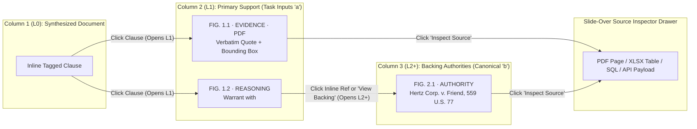

# Audit-Grounded Spatial Document Canvas: Frontend Architecture & Design Specification

This document describes the architecture, interaction model, and visual design decisions implemented in the `~/restructure/jd_screen` prototype. It serves as the technical handoff and reference guide for extending the system in future sessions.

---

## 1. Core Product & UX Philosophy

Legal, financial, and technical reviewers evaluating an AI-generated brief or memo face two failure modes in standard interfaces:
1. **Chat / Footnote Opacity:** Standard inline footnote numbers force the reader to jump back and forth to the bottom of a document or open external files, hiding whether an assertion is backed by direct factual evidence, an interpretive warrant, or an unverified assumption.
2. **Unbounded Node-Graph Chaos:** Freeform infinite-canvas node graphs (`react-flow` / Miro-style boards) destroy reading flow and overwhelm legal professionals with tangled edges and rainbow-colored boxes.

### The Solution: Progressive Bounded Broadsheet Canvas (`L0` → `L1` → `L2+`)
The frontend treats the synthesized document as an authoritative legal/analytical broadsheet (`L0`) that starts in a clean, single-column reading mode and expands rightward into structured reasoning and evidence columns **only on demand**:



---

## 2. Progressive Disclosure & Interaction Architecture

### 2.1 Three-Stage Column Expansion
Implemented in [static/app.js](file:///home/ben/restructure/jd_screen/static/app.js) and [static/styles.css](file:///home/ben/restructure/jd_screen/static/styles.css):

1. **Stage 1 — `L0` Reading Mode (`.bounded-canvas-grid.cols-1`):**
   - **Initial State:** `pinnedClaimId = null`, `expandedLevel2Ids = []`.
   - **Behavior:** Only Column 1 (`L0 · Synthesized Document`) is rendered, centered at a comfortable legal brief reading measure (`max-width: 800px` plate, `68ch` prose line width).
   - **Hover Preview:** Hovering over any highlighted `<ref>` clause displays a compact floating editorial plate (`.hover-tooltip-preview`) showing the target node's category, audit status (`Verified`, `Extrapolation`, `Assumption`), title, and number of linked `L1` support plates—without shifting the page layout.
2. **Stage 2 — `L1` Primary Support Expansion (`.bounded-canvas-grid.cols-2`):**
   - **Trigger:** Clicking any `<ref>` clause in `L0` (or clicking an `"Inspect ... →"` link inside a cross-section tension callout) sets `pinnedClaimId` and clears `expandedLevel2Ids`.
   - **Behavior:** Column 2 (`L1 · Primary Support`) opens alongside `L0`. It renders a `.claim-context-bar` summarizing the selected claim and its audit verdict, followed by `SpatialNodeCard` editorial plates (`FIG. 1.1`, `FIG. 1.2`, etc.) representing the direct `evidence`, `reasoning`, `calculation`, and `assumption` nodes from the task input documents `(a)`.
   - **SVG Bezier Connectors:** `.connector-svg-layer` dynamically computes smooth cubic Bezier paths (`M x1 y1 C ...`) with `5×5` square terminal anchors connecting the active `L0` clause button to each `L1` plate header.
3. **Stage 3 — `L2+` Backing Authorities Expansion (`.bounded-canvas-grid.cols-3`):**
   - **Trigger:** Clicking an inline `<ref>` phrase inside an `L1` `reasoning` or `calculation` card—or clicking `"View Backing (N) →"` in the plate footer—adds the child node IDs to `expandedLevel2Ids`.
   - **Behavior:** Column 3 (`L2+ · Backing Authorities`) opens to the right of `L1`, rendering the canonical `authority` or secondary `evidence` plates (`FIG. 2.1`, etc.) from `(b)` and drawing secondary Bezier connectors from the `L1` inline reference to the `L2+` plate.
4. **Step-by-Step Dismissal:**
   - Clicking the active `L0` clause again or clicking `× Close L1` collapses everything back to `cols-1`.
   - Clicking `× Close L2+` collapses only Column 3 back to `cols-2`.
   - Pressing `Escape` progressively closes the deepest active layer (`SourceInspectorDrawer` → `L2+` → `L1`).

### 2.2 Slide-Over Source Inspector Drawer (`SourceInspectorDrawer`)
When a reviewer clicks **`Inspect Source`** on any plate in `L1` or `L2+`, a slide-over drawer opens on the right (`inline-size: min(560px, 100vw)`), setting `inert` on background landmarks for keyboard and screen-reader focus isolation. The drawer renders a specialized verification view polymorphic on `locator.source_type`:
- **`pdf`:** Simulated document page header, section locator key, highlighted bounding-box region (`BBOX [x1, y1, x2, y2]`) with verbatim quote, and cryptographic SHA-256 file digest.
- **`spreadsheet`:** Workbook and `Sheet!Cell` coordinate header, formula bar (`fx =SUM(...)`), and a high-density financial table (`.sheet-table`) highlighting the target cell alongside its raw numeric primitive (`tabular-nums`).
- **`api`:** HTTP method and endpoint bar, `JSONPath` selector, payload SHA-256 digest, and formatted JSON response excerpt inside `<figure>` + `<pre tabindex="0"><code>`.
- **`internal_db`:** Database/table/row-key metadata, executed read-only SQL query block, and extracted record quote.
- **`web` / `authority`:** Snapshot timestamp, DOM selector key, `<blockquote cite="...">` excerpt, and external link (`Open Source URL ↗` / `Open Controlling Authority ↗`).

---

## 3. Visual Design System (`ben-design-prefs` Alignment)

The interface strictly implements the **Swiss Quantitative Broadsheet + Archival Press** aesthetic defined in [`ben-design-prefs`](file:///home/ben/.gemini/config/skills/ben-design-prefs/SKILL.md), tailored for legal and executive consumption:

### 3.1 Monochromatic Surface & Ink Hierarchy
Over 90% of the viewport consists of pure crisp white paper, cool stone header strips, and carbon ink rules. Color is never used for decorative flair; it is reserved exclusively for **interactive affordances** and **audit exceptions**:

| Token | Hex Value | Architectural Role |
| :--- | :--- | :--- |
| `--color-bg-app` / `--color-bg-card` | `#FFFFFF` | Pure Crisp White ground and editorial plate stages (zero beige/parchment tint) |
| `--color-bg-surface-subtle` | `#F8F9FA` | Masthead strip, column headers (`.lane-header`), plate header strips (`.plate-header-strip`), callout wells |
| `--color-bg-surface-muted` | `#F1F3F5` | Control hover states, architectural stamps (`.arch-stamp`), formula/code wells |
| `--color-border-subtle` | `#E5E7EB` | `1px` structural hairlines dividing columns, plate bodies, and table cells |
| `--color-border-mid` | `#D1D5DB` | `1px` borders on interactive buttons, selects, and stamps |
| `--color-border-strong` | `#111315` | `2px` Carbon Ink architectural top rules on columns, plates, tables, and document headers |
| `--color-text-primary` | `#111315` | Carbon Ink headlines, display titles, and primary structural accents |
| `--color-text-body` | `#374151` | Deep Charcoal longform legal prose (`17px`) and plate body copy (`14.5px`) |
| `--color-text-secondary` | `#4B5563` | Graphite metadata, tracked small-caps kickers, and table headers |
| `--color-text-muted` | `#6B7280` | Cool Slate provenance captions, section indices, and footnotes |

### 3.2 Semantic & Interactive Signal Colors
- **Oxford Navy (`#14284B` / hover `#1D3B6E` / tint `#EDF2F8` / border `#C2D3E8`):**
  - Inline clickable `<ref>` clauses in `L0` and `L1` use a subtle `#EDF2F8` fill with a `1px solid #C2D3E8` bottom rule so lawyers immediately see which phrases are backed by proof without disrupting reading flow.
  - When clicked/active (`.clause-highlight.is-active`), the clause inverts to solid Oxford Navy (`#14284B`) with `#FFFFFF` text, matching the `1.5px` Oxford Navy Bezier connector lines and the `2px` top rule of the expanded `L1`/`L2+` column lanes.
- **Terracotta Copper (`#B84A27`):** Anchors the `2px` top rule and kicker of controlling legal/regulatory `authority` plates (`.plate-authority`).
- **Deep Forest (`#14532D`):** Anchors the `2px` top rule, kicker, and active cell highlight of quantitative `calculation` and `spreadsheet` plates (`.plate-financial`).
- **Warm Ochre (`#B45309` / tint `#FFFBEB`):** Calls out clauses or nodes whose audit status is `extrapolation` or `assumption` (`.clause-highlight.is-caveat` with a `1px dashed #B45309` underline and `.arch-stamp.is-caveat`).
- **Editorial Crimson (`#991B1B`):** Reserved strictly for cross-section logical contradictions (`.tension-callout`).

### 3.3 Typography & Strict Monospace Discipline
Loaded via Google Fonts in [templates/index.html](file:///home/ben/restructure/jd_screen/templates/index.html):
1. **Editorial Serif (`'Source Serif 4'`, Georgia, serif):**
   - Used for `.brand-title` (`17px`), `.artifact-title` (`28px`), `.section-heading` (`20px`), `.card-heading` (`17px`), `.section-prose` (`17px`, line-height `1.72`, `68ch` measure), and `.evidence-blockquote` (`14.5px italic`).
   - All serif headings use `font-weight: 500` (never `600`+ semi-bold) to preserve crisp stroke contrast.
2. **Primary Sans-Serif (`'Geist'`, `'Inter Tight'`, sans-serif):**
   - Used for all UI controls, plate body prose (`.card-body-prose` at `14.5px`), provenance captions, and **Tracked Small-Caps Kickers** (`.kicker-label`, `.lane-title`, `.btn-link`, table headers: `11px`, `font-weight: 600`, `uppercase`, `letter-spacing: 0.08em`).
3. **Quantitative Monospace (`'Geist Mono'`, `'JetBrains Mono'`, monospace with `tabular-nums`):**
   - Applied via `.font-mono-data` **strictly** to quantitative metrics/percentages (`92%`), figure/section indices (`L0`, `L1`, `L2+`, `FIG. 1.1`, `SEC. 01`), page/cell/bounding-box coordinates (`p. 4`, `Sheet1!D14`, `BBOX [...]`), cryptographic hashes, and SQL/JSON/formulas. Never used on buttons, column titles, or prose labels.

### 3.4 Architectural Geometry (`2px + 1px` Broadsheet Rules)
- **Zero Pill Lozenges or Rounded SaaS Cards:** All structural plates, callouts, and document sheets use `0px` sharp corners (`--radius-plate: 0px`) anchored by a `2px solid` top rule and `1px solid #E5E7EB` side/bottom hairlines. Interactive buttons, selects, and `.arch-stamp` badges use `2px` corners (`--radius-xs: 2px`).
- **Geometric Square Markers (`▪`):** Replaced circular dot indicators with geometric square markers (`▪`) in the masthead telemetry summary, category kickers, and SVG connector endpoints.

---

## 4. Codebase Structure & API Endpoints (`~/restructure/jd_screen`)

```text
~/restructure/jd_screen/
├── main.py                              # FastAPI entrypoint + CLI runner (--provider, --model, --ingest-matter, --ask)
├── pyproject.toml                       # uv project metadata & dependencies (FastAPI, google-genai, pdfplumber, openpyxl, etc.)
├── README.md                            # Quickstart & WSL2 execution commands
├── audit_pipeline_specification.md      # Data contracts, storage architecture, 4-stage prompts & verification code
├── frontend_architecture_and_design.md  # This frontend architecture & design specification
├── canonical/                           # Standing canonical corpus (b): INDEX.md + [AUTH:...] domain markdown files
├── matters/                             # Isolated project/task workspaces (<matter_id>/inputs/raw, indexed, bundles)
├── app/
│   ├── __init__.py
│   ├── models.py                        # Pydantic schemas (Tier-1/Tier-2, stage plans, ReviewComment) + Validator/Gate/Compiler
│   ├── llm.py                           # Provider-agnostic LLMProvider (Gemini Interactions API, Anthropic, OpenAI, Mock)
│   ├── ingest.py                        # CanonicalRouter + MatterIngestor (pdfplumber, openpyxl, CSV, Markdown + Stage 2 tools)
│   ├── pipeline.py                      # 4-stage AuditPipelineRunner + FeedbackTriageDecision smart batch regenerator
│   ├── routes.py                        # FastAPI HTTP & SSE routes (/api/bundles, /api/matters, /api/bundles/*/comments|regenerate)
│   └── sample_data.py                   # Pre-loaded legal motion (28 U.S.C. § 1332) & executive candidate screen bundles
├── templates/
│   └── index.html                       # HTML5 shell, Google Fonts, local ESM importmap
├── static/
│   ├── styles.css                       # Layered CSS (@layer tokens, base, layout, components, utilities)
│   ├── app.js                           # Preact + HTM spatial canvas, inline comment composers, review queue & Ask modal
│   └── vendor/                          # Locally vendored ESM modules (zero external CDN dependency at runtime)
│       ├── preact.mjs
│       ├── hooks.mjs
│       └── htm.mjs
└── tests/
    ├── test_api.py                      # FastAPI route, ingestion, /ask, comment/regenerate & CLI integration tests
    ├── test_ingest.py                   # CanonicalRouter, MatterIngestor & Stage 2 tool unit tests
    ├── test_llm.py                      # LLMProvider, Gemini Interactions API & MockLLMProvider unit tests
    ├── test_pipeline.py                 # 4-stage pipeline & smart Stage-2 fallback unit tests
    └── test_models_and_compiler.py      # Unit tests for SectionValidator, StitchInvariantGate, CompiledGraphBuilder
```

### Backend Endpoints ([app/routes.py](file:///home/ben/restructure/jd_screen/app/routes.py))
- `GET /`: Serves [templates/index.html](file:///home/ben/restructure/jd_screen/templates/index.html).
- `GET /api/bundles` / `GET /api/bundles/{bundle_id}` / `POST /api/bundles`: Lists, retrieves, and registers Tier-2 `CompiledBundle` JSON payloads (including persisted bundles from `matters/*/bundles/`).
- `POST /api/compile`: Compiles Tier-1 `SectionOutput` blocks through `SectionValidator`, `StitchInvariantGate`, and `CompiledGraphBuilder`.
- `GET /api/matters` / `POST /api/matters` / `POST /api/matters/{matter_id}/upload` / `POST /api/matters/{matter_id}/ingest`: Lists/creates project matters, uploads task inputs, and runs deterministic coordinate stamping.
- `POST /api/matters/{matter_id}/ask` & `POST /api/matters/{matter_id}/ask/stream`: Executes the 4-stage agentic pipeline for a question `(c)` (with SSE stage progress streaming).
- `POST /api/bundles/{bundle_id}/comments`, `DELETE /api/bundles/{bundle_id}/comments/{comment_id}`, and `POST /api/bundles/{bundle_id}/regenerate`: Anchors Antigravity-style inline comments onto `L0`/`L1`/`L2+` nodes and executes batched regeneration with smart Stage-2 fallback.

---

## 5. Running & Extending in WSL2

```bash
cd ~/restructure/jd_screen

# Run the full test suite
uv run pytest tests/ -v

# Ingest raw project inputs deterministically
uv run python main.py --ingest-matter legal_motion_1332

# Start the development server
uv run python main.py --host 127.0.0.1 --port 8000 --name jd_screen --provider gemini --model gemini-4-argon
```

### Completed Interactive Workflows
1. **Matter & Canonical Ingestion Harness (`app/ingest.py`):** Deterministic parsers for `matters/<matter_id>/inputs/` (PDF bounding-box extraction via `pdfplumber`, Excel/CSV formula/value indexing via `openpyxl`, Markdown block locators) and `canonical/INDEX.md` loader.
2. **Four-Stage Agentic Runner (`app/pipeline.py`):** Full 4-stage pipeline via `LLMProvider` (defaulting to the Gemini Interactions API) runnable via CLI or the UI's **Ask Question** modal.
3. **Antigravity-Style Inline Review & Batch Regeneration:** Reviewers can queue comments and optional status overrides on any `L0` claim or `L1`/`L2+` plate, inspect the batch queue, and click **Apply Feedback & Re-compile** to incrementally regenerate affected sections.

---

## 6. Standalone Bankruptcy Case Workbench UI (`templates/bankruptcy.html`, `static/bankruptcy.js`)

Launched independently on port `8001` via `uv run python bankruptcy_main.py`, the Bankruptcy Workbench reuses the exact same `Swiss Quantitative Broadsheet + Archival Press` tokens (`static/styles.css`) and SVG cubic Bezier `L0 → L1 → L2+` interaction pattern while adapting the right-hand lane to deterministic filing preparation:

- **Official-Form-Aligned `L0` Broadsheet (`RichRefBlock`):** Renders markdown tables mapped directly to Official Form line numbers (`B 101`, `106Sum`, `Schedule A/B` 53 lines + Best Case aliases, `Schedule C` `"100% of FMV (Schwab v. Reilly)"`, `Schedules D/E/F/I/J`, `Form 122A/C` Marital Adjustment, and Chapter 13 Plan cramdown/feasibility summaries), plus side-by-side Exemption Regime Comparison cards (`bk-opt-grid`) with `Unknown Cap Risk` indicators.
- **`NextBlockerStepper` Resolution Queue (Column 2 Default):** Replaces unstructured banner stacks with a single-item Prev/Next triage workflow enforcing zero pre-filled defaults, persistent `<label htmlFor>` associations, and specialized handlers for collateral valuation, `"Unknown"` FMV toggles, bidirectional `SOFA Line 9` lawsuit sync, `§ 522(p)(2)(B)` rollover amounts, `CCP § 703.140(a)(2)` spousal waivers, and Tier-2 asset/180-day windfall confirmations. Clicking any `<ref>` cell switches Column 2 into `L1 · Source Proof & Math Trace` with SVG Bezier curves.
- **Header Table Sync & Drawers:** Includes **Sync Statutory Tables** (`POST /api/v1/bankruptcy/tables/sync`), `SourceInspectorDrawer` (coordinate bbox PDF highlighter), and `FilingPacketDrawer` (baked Official PDFs + `Form_B121_RESTRICTED.pdf`, wet-signed declaration upload, and Rule 9011 `attested = false` sign-off gate).
- **UI Craft Verification:** Audited with `impeccable detect --json static/bankruptcy.js templates/bankruptcy.html` (`[]`, zero P0/P1 violations) and `node --check static/bankruptcy.js`.
