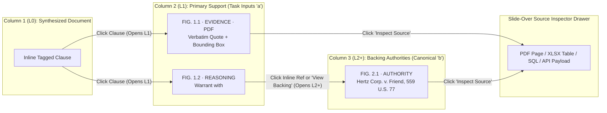

# Audit-Grounded Spatial Document Canvas: Frontend Architecture & Design Specification

This document describes the architecture, interaction model, and visual design decisions implemented in the `~/restructure/jd_screen` prototype. It serves as the technical handoff and reference guide for extending the system in future sessions.

---

## 1. Core Product & UX Philosophy

Legal, financial, and technical reviewers evaluating an AI-generated brief or memo face two failure modes in standard interfaces:
1. **Chat / Footnote Opacity:** Standard inline footnote numbers force the reader to jump back and forth to the bottom of a document or open external files, hiding whether an assertion is backed by direct factual evidence, an interpretive warrant, or an unverified assumption.
2. **Unbounded Node-Graph Chaos:** Freeform infinite-canvas node graphs (`react-flow` / Miro-style boards) destroy reading flow and overwhelm legal professionals with tangled edges and rainbow-colored boxes.

### The Solution: Progressive Bounded Broadsheet Canvas (`L0` → `L1` → `L2+`)
The frontend treats the synthesized document as an authoritative legal/analytical broadsheet (`L0`) that starts in a clean, single-column reading mode and expands rightward into structured reasoning and evidence columns **only on demand**:



---

## 2. Progressive Disclosure & Interaction Architecture

### 2.1 Three-Stage Column Expansion
Implemented across shared core ([static/core/](file:///home/ben/restructure/jd_screen/static/core/)), compiler views ([static/apps/](file:///home/ben/restructure/jd_screen/static/apps/)), and [static/styles.css](file:///home/ben/restructure/jd_screen/static/styles.css):

1. **Stage 1 — `L0` Reading Mode (`.bounded-canvas-grid.cols-1`):**
   - **Initial State:** `pinnedClaimId = null`, `expandedLevel2Ids = []`.
   - **Behavior:** Only Column 1 (`L0 · Synthesized Document`) is rendered, centered at a comfortable legal brief reading measure (`max-width: 800px` plate, `68ch` prose line width).
   - **Hover Preview:** Hovering over any highlighted `<ref>` clause displays a compact floating editorial plate (`.hover-tooltip-preview`) showing the target node's category, audit status (`Verified`, `Extrapolation`, `Assumption`), title, and number of linked `L1` support plates—without shifting the page layout.
2. **Stage 2 — `L1` Primary Support Expansion (`.bounded-canvas-grid.cols-2`):**
   - **Trigger:** Clicking any `<ref>` clause in `L0` (or clicking an `"Inspect ..."` link inside a cross-section tension callout) sets `pinnedClaimId` and clears `expandedLevel2Ids`.
   - **Behavior:** Column 2 (`L1 · Primary Support`) opens alongside `L0`. It renders a `.claim-context-bar` summarizing the selected claim and its audit verdict, followed by `SpatialNodeCard` editorial plates (`FIG. 1.1`, `FIG. 1.2`, etc.) representing the direct `evidence`, `reasoning`, `calculation`, and `assumption` nodes from the task input documents `(a)`.
   - **SVG Bezier Connectors:** `.connector-svg-layer` dynamically computes smooth cubic Bezier paths (`M x1 y1 C ...`) with `5×5` square terminal anchors connecting the active `L0` clause button to each `L1` plate header.
3. **Stage 3 — `L2+` Backing Authorities Expansion (`.bounded-canvas-grid.cols-3`):**
   - **Trigger:** Clicking an inline `<ref>` phrase inside an `L1` `reasoning` or `calculation` card—or clicking `"View Backing (N)"` in the plate footer—adds the child node IDs to `expandedLevel2Ids`.
   - **Behavior:** Column 3 (`L2+ · Backing Authorities`) opens to the right of `L1`, rendering the canonical `authority` or secondary `evidence` plates (`FIG. 2.1`, etc.) from `(b)` and drawing secondary Bezier connectors from the `L1` inline reference to the `L2+` plate.
4. **Step-by-Step Dismissal:**
   - Clicking the active `L0` clause again or clicking `× Close L1` collapses everything back to `cols-1`.
   - Clicking `× Close L2+` collapses only Column 3 back to `cols-2`.
   - Pressing `Escape` progressively closes the deepest active layer (`SourceInspectorDrawer` → `L2+` → `L1`).

### 2.2 Slide-Over Source Inspector Drawer (`static/core/inspector.js`)
When a reviewer clicks **`Source`** / **`Inspect Source PDF`** on any plate in `L1` or `L2+`, the shared `SourceInspectorDrawer` opens on the right (`inline-size: min(560px, 100vw)`), setting `inert` on background landmarks for keyboard and screen-reader focus isolation. The drawer renders a specialized verification view polymorphic on `locator.source_type`:
- **`pdf`:** Simulated document page header, section locator key, highlighted bounding-box region (`BBOX [x1, y1, x2, y2]`) with verbatim quote, and cryptographic SHA-256 file digest.
- **`spreadsheet`:** Workbook and `Sheet!Cell` coordinate header, formula bar (`fx =SUM(...)`), and a high-density financial table (`.sheet-table`) highlighting the target cell alongside its raw numeric primitive (`tabular-nums`).
- **`calculation_ledger`:** Dedicated `.ledger-inspector-box` inspecting deterministic cross-compiler `VerifiedLedgerSnapshot` files (`ledgers/<app>.json`), rendering the JSONPath key, SHA-256 snapshot digest, key/value metric table, and link to inspect the full verified ledger JSON.
- **`event_log`:** Dedicated `.event-log-box` displaying structured event log IDs, JSONPath coordinates, formatted event JSON, and verbatim excerpts.
- **`api`:** HTTP method and endpoint bar, `JSONPath` selector, payload SHA-256 digest, and formatted JSON response excerpt inside `<figure>` + `<pre tabindex="0"><code>`.
- **`internal_db`:** Database/table/row-key metadata, executed read-only SQL query block, and extracted record quote.
- **`web` / `markdown` / `docx` / `authority`:** Snapshot timestamp or `.doc-excerpt-frame`, `<blockquote cite="...">` excerpt, and SVG `<ExternalIcon />` action links (`Open Controlling Authority` / `Open Original PDF`).

---

## 3. Visual Design System (`ben-design-prefs` Alignment)

The interface strictly implements the **Swiss Quantitative Broadsheet + Archival Press** aesthetic defined in [`ben-design-prefs`](file:///home/ben/.gemini/config/skills/ben-design-prefs/SKILL.md), tailored for legal and executive consumption:

### 3.1 Monochromatic Surface & Ink Hierarchy
Over 90% of the viewport consists of pure crisp white paper, cool stone header strips, and carbon ink rules. Color is never used for decorative flair; it is reserved exclusively for **interactive affordances** and **audit exceptions**:

| Token | Hex Value | Architectural Role |
| :--- | :--- | :--- |
| `--color-bg-app` / `--color-bg-card` | `#FFFFFF` | Pure Crisp White ground and editorial plate stages (zero beige/parchment tint) |
| `--color-bg-surface-subtle` | `#F8F9FA` | Masthead strip, column headers (`.lane-header`), plate header strips (`.plate-header-strip`), callout wells |
| `--color-bg-surface-muted` | `#F1F3F5` | Control hover states, architectural stamps (`.arch-stamp`), formula/code wells |
| `--color-border-subtle` | `#E5E7EB` | `1px` structural hairlines dividing columns, plate bodies, and table cells |
| `--color-border-mid` | `#D1D5DB` | `1px` borders on interactive buttons, selects, and stamps |
| `--color-border-strong` | `#111315` | `2px` Carbon Ink architectural top rules on columns, plates, tables, and document headers |
| `--color-text-primary` | `#111315` | Carbon Ink headlines, display titles, and primary structural accents |
| `--color-text-body` | `#374151` | Deep Charcoal longform legal prose (`17px`) and plate body copy (`14.5px`) |
| `--color-text-secondary` | `#4B5563` | Graphite metadata, tracked small-caps kickers, and table headers |
| `--color-text-muted` | `#6B7280` | Cool Slate provenance captions, section indices, and footnotes |

### 3.2 Semantic & Interactive Signal Colors
- **Oxford Navy (`#14284B` / hover `#1D3B6E` / tint `#EDF2F8` / border `#C2D3E8`):**
  - Inline clickable `<ref>` clauses in `L0` and `L1` use a subtle `#EDF2F8` fill with a `1px solid #C2D3E8` bottom rule so lawyers immediately see which phrases are backed by proof without disrupting reading flow.
  - When clicked/active (`.clause-highlight.is-active`), the clause inverts to solid Oxford Navy (`#14284B`) with `#FFFFFF` text, matching the `1.5px` Oxford Navy Bezier connector lines and the `2px` top rule of the expanded `L1`/`L2+` column lanes.
- **Terracotta Copper (`#B84A27`):** Anchors the `2px` top rule and kicker of controlling legal/regulatory `authority` plates (`.plate-authority`).
- **Deep Forest (`#14532D`):** Anchors the `2px` top rule, kicker, and active cell highlight of quantitative `calculation` and `spreadsheet` plates (`.plate-financial`).
- **Warm Ochre (`#B45309` / tint `#FFFBEB`):** Calls out clauses or nodes whose audit status is `extrapolation` or `assumption` (`.clause-highlight.is-caveat` with a `1px dashed #B45309` underline and `.arch-stamp.is-caveat`).
- **Editorial Crimson (`#991B1B`):** Reserved strictly for cross-section logical contradictions (`.tension-callout`).

### 3.3 Typography & Strict Monospace Discipline
Loaded via Google Fonts in [templates/bankruptcy.html](file:///home/ben/restructure/jd_screen/templates/bankruptcy.html) and [templates/research.html](file:///home/ben/restructure/jd_screen/templates/research.html):
1. **Editorial Serif (`'Source Serif 4'`, Georgia, serif):**
   - Used for `.brand-title` (`17px`), `.artifact-title` (`28px`), `.section-heading` (`20px`), `.card-heading` (`17px`), `.section-prose` (`17px`, line-height `1.72`, `68ch` measure), and `.evidence-blockquote` (`14.5px italic`).
   - All serif headings use `font-weight: 500` (never `600`+ semi-bold) to preserve crisp stroke contrast.
2. **Primary Sans-Serif (`'Geist'`, `'Inter Tight'`, sans-serif):**
   - Used for all UI controls, plate body prose (`.card-body-prose` at `14.5px`), provenance captions, and **Tracked Small-Caps Kickers** (`.kicker-label`, `.lane-title`, `.btn-link`, table headers: `11px`, `font-weight: 600`, `uppercase`, `letter-spacing: 0.08em`).
3. **Quantitative Monospace (`'Geist Mono'`, `'JetBrains Mono'`, monospace with `tabular-nums`):**
   - Applied via `.font-mono-data` **strictly** to quantitative metrics/percentages (`92%`), figure/section indices (`L0`, `L1`, `L2+`, `FIG. 1.1`, `SEC. 01`), page/cell/bounding-box coordinates (`p. 4`, `Sheet1!D14`, `BBOX [...]`), cryptographic hashes, and SQL/JSON/formulas. Never used on buttons, column titles, or prose labels.

### 3.4 Architectural Geometry (`2px + 1px` Broadsheet Rules)
- **Zero Pill Lozenges or Rounded SaaS Cards:** All structural plates, callouts, and document sheets use `0px` sharp corners (`--radius-plate: 0px`) anchored by a `2px solid` top rule and `1px solid #E5E7EB` side/bottom hairlines. Interactive buttons, selects, and `.arch-stamp` badges use `2px` corners (`--radius-xs: 2px`).
- **Geometric Square Markers & SVG Icons:** Replaced circular dot indicators with geometric square markers and replaced raw Unicode arrow characters with uniform 16px vector SVG primitives (`Icon`, `ExternalIcon`, `ArrowLeftIcon`, `ArrowRightIcon`).

---

## 4. Codebase Structure & `/api/v1/` Endpoints (`~/restructure/jd_screen`)

```text
~/restructure/jd_screen/
├── main.py                                   # Unified platform server & CLI (--apps, --default-app, --sync-tables, port 8000)
├── bankruptcy_main.py                        # Single-app Bankruptcy preset (port 8001, hides App Switcher)
├── pyproject.toml                            # uv project metadata & dependencies
├── canonical/                                # Standing canonical corpus (b): INDEX.md + [AUTH:...] domain files + tables/
├── matters/                                  # Isolated matter workspaces (<id>/inputs/{raw,indexed}, ledgers/*.json, bundles/)
├── app/
│   ├── server.py                             # COMPILER_REGISTRY, create_platform_app, /api/v1/{apps,tables,canonical,matters}/*
│   ├── core/                                 # Shared platform spine: bundle, provenance, workspace, gate, compiler, verifier, ingest, llm, ocr, pii, tables, pdf_forms
│   └── compilers/
│       ├── research/                         # /research compiler (pipeline, sample_data, service, routes)
│       └── bankruptcy/                       # /bankruptcy compiler (schema, extractor, calculators/, rules_auditor, bundle_adapter, form_binder, districts/, vault, service, routes)
├── templates/
│   ├── bankruptcy.html                       # Default `/` (`/bankruptcy`) ESM shell
│   └── research.html                         # Research `/research` ESM shell
├── static/
│   ├── styles.css                            # Layered CSS (@layer tokens, base, layout, components, utilities)
│   ├── core/
│   │   ├── shell.js                          # PlatformShell (auto-hiding App Switcher), SVG icons, formatters, resolveSourceFileUrl
│   │   ├── canvas.js                         # TraceabilityCanvas, BezierConnectorLayer, RichRefBlock, renderAnnotatedText
│   │   ├── inspector.js                      # Polymorphic SourceInspectorDrawer (PDF, XLSX, calculation_ledger, event_log, API, DB, web)
│   │   └── stepper.js                        # TriageStepperFrame (blocker/advisory triage frame)
│   ├── apps/
│   │   ├── bankruptcy/app.js                 # Bankruptcy Workbench slots (Official Form L0 tables, 12-rule stepper, FilingPacketDrawer)
│   │   └── research/app.js                   # Research Broadsheet slots (AskPipelineDialog, CorpusManagerModal, CheckpointReviewModal)
│   └── vendor/                               # Locally vendored ESM modules (preact.mjs, hooks.mjs, htm.mjs)
└── tests/                                    # Unit, integration, UI craft/static serving, ledger bridge, and granular live eval tests
```

### Backend Endpoints ([app/server.py](file:///home/ben/restructure/jd_screen/app/server.py), [app/compilers/research/routes.py](file:///home/ben/restructure/jd_screen/app/compilers/research/routes.py), [app/compilers/bankruptcy/routes.py](file:///home/ben/restructure/jd_screen/app/compilers/bankruptcy/routes.py))
- **Platform Discovery & UI Routes:**
  - `GET /` → `307 /bankruptcy` (or configured `default_app`); `GET /bankruptcy` (`templates/bankruptcy.html`); `GET /research` (`templates/research.html`).
  - `GET /api/v1/apps` & `GET /api/v1/apps/cases` — Lists mounted compiler descriptors (drives auto-hiding `PlatformShell` App Switcher) and case summaries.
  - `GET /api/v1/tables/{domain}` & `POST /api/v1/tables/{domain}/sync` — Reference table inspection and SHA-256/staleness verification.
  - `GET/POST /api/v1/canonical/*` & `GET/POST /api/v1/matters/*` (including `/api/v1/matters/{matter_id}/ledgers`) — Shared corpus management, coordinate ingestion, and cross-compiler ledger inspection.
- **Research Compiler Routes (`/api/v1/research/*`):**
  - `GET/POST /api/v1/research/bundles*`, `POST /api/v1/research/compile`, `GET/POST /api/v1/research/blueprints*`, `POST /api/v1/research/matters/{id}/ask[/stream]`, `GET/POST /api/v1/research/runs/{id}[/stream|/resume/stream]`, `POST /api/v1/research/bundles/{id}/comments|regenerate`.
- **Bankruptcy Compiler Routes (`/api/v1/bankruptcy/*`):**
  - `GET/POST /api/v1/bankruptcy/tables*`, `GET/POST /api/v1/bankruptcy/matters*`, `/upload`, `/extract`, `/recalculate`, `PATCH /fields`, `POST /questions/{qid}/answer`, `POST /tensions/{tid}/resolve`, `POST /declaration`, `POST /compile-packet`, `GET /packet/files/{fn}`, `GET /credentials`, `POST /submit`.

---

## 5. Running & Verification in WSL2

```bash
cd ~/restructure/jd_screen

# Run full offline suite (syntax, UI craft, and unit/API tests)
uv run pytest tests/ -v
uv run python main.py --sync-tables bankruptcy
node --check static/core/*.js static/apps/*/*.js

# Start unified server co-mounting /bankruptcy (default) and /research on port 8000
uv run python main.py --host 127.0.0.1 --port 8000 --apps bankruptcy,research --default-app bankruptcy

# Or start Bankruptcy-only on port 8001 (auto-hides App Switcher)
uv run python bankruptcy_main.py --host 127.0.0.1 --port 8001
```

---

## 6. Three-Tier Slot-Based Sharing Across Applications

Both `/bankruptcy` and `/research` (and any future compiler such as Clinical Case Triage or Applicant Review) share `static/core/{shell,canvas,inspector,stepper}.js` and adapt UI behavior purely through props/slots:
1. **`PlatformShell` (`static/core/shell.js`):** Renders `.top-bar`, mounts the App Switcher `<select>` automatically when `GET /api/v1/apps` reports `apps.length > 1` (and hides it in single-app deploys), and fills `selectorSlot`, `filterSlot`, `headerActions`, `bannerSlot`, and `overlaySlots`.
2. **`TraceabilityCanvas` (`static/core/canvas.js`):** Supports both Research's progressive `1 → 2 → 3` expansion (`cols-1` → `cols-2` → `cols-3` with interactive `BezierConnectorLayer` link comment handles) and Bankruptcy's queue-to-trace default (`cols-2` with Column 2 defaulting to `NextBlockerStepper` and flipping to `L1 · Source Proof` on `<ref>` click).
3. **`TriageStepperFrame` (`static/core/stepper.js`):** Houses Prev/Next triage navigation and blocker/advisory counters while delegating each rule's domain inputs via `children`.
4. **`SourceInspectorDrawer` (`static/core/inspector.js`):** Polymorphically renders PDF bboxes, spreadsheets, SQL/API snapshots, `calculation_ledger` tables, and `event_log` entries across every compiler.
5. **UI Craft Verification:** Audited with `impeccable detect --json` across all 6 JS modules + both HTML templates (`[]`, zero P0/P1 findings) and `node --check` exit `0`.
